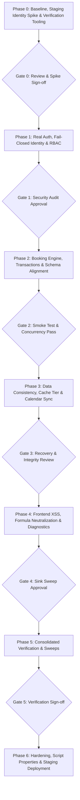

# 📅 Implementation Plan: MUIDS Lab Booking System Security & Functional Remediation (v1.4.0a)

**Target System:** `Lab Oops OS` — Project 01 (`Smart Lab Booking System`)  
**Source Location:** `App_Script/` (Google Apps Script web app, 50 files)  
**Governing Standard:** `AGENTS.md`, `lab-oops-standards`, `gas-best-practices`, `mattpocock/skills`  
**Reference Input:** Executive Security Audit & Remediation Plan (Findings F-01 through F-17, Revisions R-01 through R-16, Owner Decisions 2026-10-11)

---

## 🔄 Changes From Previous Version (v1.0 ➔ v1.4.0a)

| Revision ID | Description of Gap / Misalignment | How & Where Addressed in Plan v1.4.0a |
|---|---|---|
| **R-01** | Identity / deployment model undecided; `getActiveUser().getEmail()` can be blank | Added **Phase 0 Identity Spike** (§Phase 0 & §R-01); produces `docs/IDENTITY_DECISION.md` (created during Phase 0 execution on staging); Phase 1 blocked until spike resolves. |
| **R-02** | Whitelist domains garbled/assumed; student domain authorization gap | Domains confirmed strictly to 3 (@mahidol.ac.th, @student.mahidol.ac.th, @student.mahidol.edu; @mahidol.edu prohibited). Student access posture documented (§2.1). |
| **R-03** | Incomplete role $\times$ action matrix; missing canonical permissions policy | Added canonical `PERMISSIONS` table (§2.1); all cells confirmed per Owner directives (Admin approves, HoD view/stats only, TALT/Admin manage outages & assign tech, Admin config only). |
| **R-04** | Postponement / reschedule missing from booking state machine | Added explicit two-way approval-gated state machine (§2.2): TALT swap requires Teacher approval; Teacher postponement requires TALT approval. |
| **R-05** | Federated cross-sheet data access lacked concrete design | Added Dedicated Cross-Sheet Architecture (§2.3 & §Phase 2); read-only Master DB & Timetable 2026 enforcement; all 8 live sheet headers incorporated. |
| **R-06** | Vulnerability roadmap & sensitive IDs exposed in public repository | Owner confirmed repository remains public for AI auditing (§5, D-09); all real IDs replaced with placeholders (`<LOCAL_SPREADSHEET_ID>`, `<MASTER_DB_ID>`, `<TIMETABLE_2026_ID>`, `<CALENDAR_ID>`). |
| **R-07** | Script Properties config accessor deferred to Phase 6 | Shifted secure Config Accessor into **Phase 1** (§Phase 1.4) to support `ENABLE_DIAGNOSTICS` and break-glass admin early. |
| **R-08** | F-02 not fully covered; read APIs unauthenticated; internal functions exposed | Added explicit workstreams in Phase 1 (§Phase 1.3) to privatize internal functions (`_` suffix), scope read APIs, and enforce callable allowlist. |
| **R-09** | Lead time policy (24h) assumed without explicit owner confirmation | Confirmed by Owner at 24h against `Asia/Bangkok`; TALT bypass permitted with mandatory audit record (§2.4). |
| **R-10** | Execution environment for tests undefined | Defined 2-tier testing environment (§Phase 0 & §3): Node.js pure-logic stubs + Staging Apps Script integration copy. |
| **R-11** | Locking details incomplete (flush, wait vs try, bounded timeout) | Mandated `SpreadsheetApp.flush()` before releasing lock (§Phase 2.4); timeout handling with structured retryable error. |
| **R-12** | Idempotency design unspecified | Specified client request ID + `CacheService` 6-hour TTL replay cache backed by natural-key collision checks (§Phase 2.5). |
| **R-13** | Federated Master DB caching invalidation flawed (cannot write to Master DB) | Bounded Master DB cache TTLs (5 min max confirmed) and eliminated Script Properties PII caching (§Phase 3.3). |
| **R-14** | Calendar sync lacked stable idempotency marker & cancellation hooks | Specified Calendar event ID persistence, duplicate lookup by tag/id, cancellation deletion, and retry backoff (§Phase 3.2). |
| **R-15** | Minimal OAuth scopes incomplete (missing identity lookup scope) | Added scope derivation from AST/grep; test scopes in staging to prevent identity breakage (§Phase 6.2). |
| **R-16** | Rollback & data safety procedures lacked concrete steps | Mandated dated backup copy of local spreadsheet and explicit clasp version rollback manual (§Phase 0 & §Phase 6). |

---

## 🏛️ 1. Skills & Standards Applied

The repository operates under a strict hierarchy of governing engineering standards.

### 1.1 Available Skills & Inventory Mapping

| Owner Mention | Installed / Available Skill | Exact File Path | Mapping Certainty |
|---|---|---|---|
| `"lab-opps-master"` | **`lab-oops-standards`** | `C:\Users\MUIDS\Documents\Projects\Lab Oops\.agents\skills\lab-oops-standards\SKILL.md` | **Certain** (Master architectural standard for Lab Oops OS) |
| `"app-script-best-practices"` | **`gas-best-practices`** | `C:\Users\MUIDS\Documents\Projects\Lab Oops\.agents\skills\gas-best-practices\SKILL.md` | **Certain** (GAS production standards, LockService, ScriptCache, Result envelope) |
| `"matt-pocker"` | **`setup-matt-pocock-skills`** | `C:\Users\MUIDS\Documents\Projects\Lab Oops\.agents\skills\setup-matt-pocock-skills\SKILL.md` | **Certain** (Matt Pocock engineering workflow: `docs/`, `GLOSSARY.md`, ADRs) |

### 1.2 Precedence Hierarchy & Conflict Resolution Rules
1. **Security & Owner Decisions Rule:** Security audit findings (F-01..F-17) and verified Owner decisions **strictly override** any default skill guidance.
2. **Architecture Standard Precedence:**
   - **Primary:** `lab-oops-standards` governs RBAC, branding, directory layout (`App_Script/`, `docs/`), 3 mandatory sheets (`Config`, `Logs`, `Stats`), and SuperAdmin governance.
   - **Complementary:** `gas-best-practices` governs Apps Script execution boundaries: universal `Result<T>` envelope, `LockService` critical sections, spreadsheet batching, and OAuth scopes.
   - **Scaffold:** `setup-matt-pocock-skills` governs documentation layout (`docs/`), ADR logging, and issue tracking.

### 1.3 Skills & Standards Applied Table

| Phase | Skill (Exact Name) | Rule / Section Used | How It Shapes the Work | Checklist ID Proving It |
|---|---|---|---|---|
| **Phase 0** | `setup-matt-pocock-skills` | Domain docs layout (`docs/adr/`, `GLOSSARY.md`) | Establishes single-context documentation and checklist structure | `P0-03`, `P0-04`, `P0-06` |
| **Phase 0** | `lab-oops-standards` | §1 Core Developer Context | Establishes `Asia/Bangkok` timezone, Academic Year 2026, SuperAdmin context | `P0-07`, `P0-08` |
| **Phase 1** | `lab-oops-standards` | §1 & §13 RBAC & TALT Team Rule | Prohibits `"TALT"` role string; enforces `"TA"`, `"LabTech"`, `"Teacher"`, `"Admin"`, `"HoD"` | `P1-07`, `P1-08`, `P1-09` |
| **Phase 1** | `gas-best-practices` | `rules/security.md` & `rules/web-app-rpc.md` | Enforces fail-closed identity; eliminates client identity parameters | `P1-01`, `P1-02`, `P1-10` |
| **Phase 2** | `gas-best-practices` | `rules/lock-service.md` & `rules/spreadsheet-ops.md` | Enforces atomic conflict check inside `LockService`; mandates `SpreadsheetApp.flush()` before unlock | `P2-07`, `P2-08`, `P2-09` |
| **Phase 2** | `lab-oops-standards` | §4 Database Schemas & Mandatory Sheets | Aligns `Bookings`, `Outages`, `Config`, `Logs`, `Stats` schema contracts | `P2-01`, `P2-02`, `P2-17` |
| **Phase 3** | `gas-best-practices` | `rules/cache-service.md` & `rules/data-integrity.md` | Mandates targeted cell updates instead of full-range rewrites; sets cache TTLs | `P3-01`, `P3-07`, `P3-10` |
| **Phase 4** | `gas-best-practices` | `rules/htmlservice-frontend.md` & `rules/error-handling.md` | Enforces formula sanitization (`sanitizeCell_`) and eliminates `innerHTML` XSS | `P4-01`, `P4-03`, `P4-05` |
| **Phase 5** | `setup-matt-pocock-skills` | Issue tracker & Verification | Mandates 100% traceability linking findings to test logs in `docs/TEST_RESULTS.md` | `P5-04`, `P5-05` |
| **Phase 6** | `gas-best-practices` | `rules/properties-service.md` & `rules/deployment-versioning.md` | Eliminates hardcoded IDs into Script Properties; minimal OAuth scopes; rollback manual | `P6-01`, `P6-03`, `P6-07` |

---

## 🔐 2. Core Architectural Specifications

### 2.1 Canonical Role $\times$ Action Matrix (`PERMISSIONS`)

The system enforces authorization via **Policy-as-Data** stored in `Utils_Security.js`. All API endpoints, gatekeeper checks, and unit tests evaluate this matrix:

```javascript
TALT_STAFF = ["TA", "LabTech", "Admin", "HoD"];  // Named group constant, never a database role string
VALID_ROLES = ["Teacher", "TA", "LabTech", "Admin", "HoD", "Student"];
```

| Action Identifier | Description | Teacher | TA | LabTech | Admin | HoD | Student | Status |
|---|---|:---:|:---:|:---:|:---:|:---:|:---:|:---:|
| `ACTION_SUBMIT_BOOKING` | Submit new booking slot(s) | Own | Own/On-behalf | Own/On-behalf | Any | Any | Denied* | `CONFIRMED` |
| `ACTION_VIEW_OWN_BOOKINGS` | View own booking history | Own | Own | Own | Own | Own | Denied* | `CONFIRMED` |
| `ACTION_VIEW_ALL_BOOKINGS` | View Master Calendar (all school bookings) | **Allowed** | Allowed | Allowed | Allowed | Allowed | Denied* | `CONFIRMED` |
| `ACTION_VIEW_SCHEDULE` | View room availability radar | Allowed | Allowed | Allowed | Allowed | Allowed | Allowed | `CONFIRMED` |
| `ACTION_CANCEL_BOOKING` | Cancel existing booking | **Own Only** | Any | Any | Any | Any | Denied | `CONFIRMED` |
| `ACTION_APPROVE_BOOKING` | Approve a pending booking | Denied | **Allowed** | **Allowed** | **Allowed** | **Denied** | Denied | `CONFIRMED` |
| `ACTION_REJECT_BOOKING` | Reject a pending booking | Denied | **Allowed** | **Allowed** | **Allowed** | **Denied** | Denied | `CONFIRMED` |
| `ACTION_REQUEST_POSTPONE` | Request postponement/reschedule | Own | Own/On-behalf | Own/On-behalf | Any | Any | Denied | `CONFIRMED` |
| `ACTION_APPROVE_POSTPONE` | Approve postponement swap | Reciprocal** | **Allowed** | **Allowed** | **Allowed** | **Denied** | Denied | `CONFIRMED` |
| `ACTION_ASSIGN_ROOM_TECH` | Assign technician / override room | Denied | **Allowed** | **Allowed** | **Allowed** | Denied | Denied | `CONFIRMED` |
| `ACTION_MANAGE_OUTAGES` | Create/modify maintenance & SetupHold | Denied | **Allowed** | **Allowed** | **Allowed** | Denied | Denied | `CONFIRMED` |
| `ACTION_EDIT_CONFIG` | Modify ecosystem configuration | Denied | **Denied** | **Denied** | **Allowed** | **Denied** | Denied | `CONFIRMED` |
| `ACTION_VIEW_LOGS_STATS` | Access telemetry & forensic logs | **Allowed** | **Allowed** | **Allowed** | **Allowed** | **Allowed** | Denied | `CONFIRMED` |
| `ACTION_RUN_DIAGNOSTICS` | Run system diagnostics & UAT | Denied | Denied | Denied | **Allowed** | Denied | Denied | `CONFIRMED` |
| `ACTION_TRIGGER_CALENDAR` | Manually invoke calendar sync | Denied | Allowed | Allowed | Allowed | Allowed | Denied | `CONFIRMED` |

*\*Student Domain Policy: Accounts from `@student.mahidol.ac.th` and `@student.mahidol.edu` pass perimeter domain validation, but hold no booking permissions until the future Student Independent Project module is deployed.*  
*\*\*Reciprocal Postponement Approval: See §2.2 for two-way approval flow.*

#### Booking Ownership & Audit Attribution (§10 Clarification):
- **Booking Owner:** Defined strictly by the `TargetUserID` / `Teacher` column (`TEACHER_EMAIL`). If a TALT member books on behalf of a teacher, the teacher is the legal booking owner with cancellation and postponement rights.
- **On-Behalf Audit Attribution:** When a TALT member books on behalf of a teacher, the record explicitly captures both:
  - `SubmittedByUserID` = TALT member's email/ID (the operator who submitted the transaction).
  - `TargetUserID` / `Teacher` = Teacher's email/ID (the booking owner).
  - `AssignedTaltID` / `AssignedTaltName` = Assigned technician (if allocated).

---

### 2.2 Booking Lifecycle & Two-Way Postponement State Machine (§8 Clarification)

```mermaid
stateDiagram-v2
    [*] --> PENDING: Submit Booking (Teacher / TALT on-behalf)
    PENDING --> APPROVED: Approve (TA / LabTech / Admin)
    PENDING --> DENIED: Deny with Reason (TA / LabTech / Admin)
    PENDING --> CANCELLED: Cancel (Owner if Teacher; Any if TALT)
    
    APPROVED --> CANCELLED: Cancel (Owner if Teacher; Any if TALT)
    
    APPROVED --> POSTPONE_PENDING_TALT: Teacher Requests Postponement
    POSTPONE_PENDING_TALT --> APPROVED: TALT Approves Swap (Old Released, Target Reserved)
    POSTPONE_PENDING_TALT --> APPROVED: TALT Rejects Swap (Reverts to Original Slot)
    
    APPROVED --> POSTPONE_PENDING_TEACHER: TALT Initiates Slot Swap
    POSTPONE_PENDING_TEACHER --> APPROVED: Teacher Approves Swap (Old Released, Target Reserved)
    POSTPONE_PENDING_TEACHER --> APPROVED: Teacher Rejects Swap (Reverts to Original Slot)
    
    DENIED --> [*]
    CANCELLED --> [*]
```



#### State Transition Rules:
1. **Slot Blocking:** Slots in `PENDING`, `POSTPONE_PENDING_TALT`, and `POSTPONE_PENDING_TEACHER` actively block conflicting bookings for the room/period.
2. **Denial Persistence & Remark Stacking:** Denials set `STATUS = "Denied"` and append the denial reason into `Remark` chronologically descending/ascending without overwriting previous remarks.
3. **Two-Way Approval Postponement Protocol:**
   - **Teacher-Initiated Postponement:** If the booking teacher requests a reschedule, the booking transitions to `POSTPONE_PENDING_TALT`. A notification and approval request are routed to TALT staff (`TA`, `LabTech`, `Admin`). Upon TALT approval, the atomic swap executes inside `LockService`.
   - **TALT-Initiated Postponement:** If TALT staff move or swap a teacher's booked slot, the booking transitions to `POSTPONE_PENDING_TEACHER`. An approval request is sent to the booking owner (`Teacher`). The slot is not finalized until the teacher confirms.
   - **Atomic Execution:** When approved by the reciprocal party, old slot release and target slot reservation occur **inside a single `LockService` critical section**, verifying room availability, active `SetupHold` outages, bell schedules, and lead time.

---

### 2.3 Cross-Sheet Federated Data Architecture & Live Schemas (10 Tabs across 3 Spreadsheets)

```mermaid
flowchart LR
    subgraph LocalSheet["Local Transactional Sheet (<LOCAL_SPREADSHEET_ID>)"]
        B["Bookings (25 cols)"]
        O["Outages (13 cols)"]
        D["Duties (8 cols)"]
        C["Config (5 cols)"]
        L["Logs (7 cols)"]
        S["Stats (12 cols)"]
    end
    
    subgraph MasterDB["Master DB 2026 (<MASTER_DB_ID>) - READ ONLY"]
        U["Users (8 cols)"]
        SUB["Subjects (5 cols)"]
        RM["Room (4 cols - Labs)"]
        AC["Academic_Calendar (6 cols)"]
        BS["Bell_Schedules (8 cols)"]
    end
    
    subgraph TimetableDB["Timetable 2026 (<TIMETABLE_2026_ID>) - READ ONLY"]
        TT["Index (7 cols - TeacherTimeTables)"]
    end
    
    App["Apps Script Engine"] -->|Read / Write with LockService| LocalSheet
    App -->|Read-Only Cached Access (TTL <= 5m)| MasterDB
    App -->|Read-Only Cached Access (TTL <= 5m)| TimetableDB
```

#### Authoritative Live Header Contracts:

1. **`Bookings` (Local):**  
   `BookingID` | `BatchID` | `SubmittedByUserID` | `User` | `TargetUserID` | `Teacher` | `Subject` | `LabID` | `LabName` | `Date` | `Period` | `Section` | `DayType` | `BellType` | `TimeSlotID` | `LabTitle` | `Status` | `BookingTimeStamp` | `ConfirmUserId` | `ConfirmedBy` | `AssignedTaltID` | `AssignedTaltName` | `Remark` | `GCalEventID` | `LinkedBookingID`

2. **`Outages` (Local):**  
   `OutageID` | `LabID` | `LabName` | `StartDate` | `EndDate` | `AllDay` | `StartPeriod` | `EndPeriod` | `Reason` | `Status` | `OutageType` | `LinkedSubject` | `SuppressEmail`

3. **`Duties` (Local):**  
   `DutyID` | `TeachingBlockID` | `UserID` | `Teacher` | `DayType` | `Period` | `Subject` | `DutyDescription`

4. **`Config` (Local):**  
   `Category` | `Config_Key` | `Config_Value` | `Description` | `Placeholders`

5. **`Logs` (Local):**  
   `Timestamp` | `User ID` | `Action` | `Result Status` | `Total Latency (ms)` | `Lock Contention?` | `Error/Outcome Message`

6. **`Stats` (Local — Designed for Telemetry & Forensic Analytics):**  
   `StatDate` | `MetricName` | `MetricCategory` | `PeriodIdentifier` | `TotalRequests` | `TotalApproved` | `TotalRejected` | `TotalCancelled` | `UrgentBypassCount` | `AvgLatencyMs` | `LockContentionCount` | `LastUpdated`

7. **`Users` (Master DB 2026 — Read-Only):**  
   `UserID` | `FirstName` | `LastName` | `Email` | `DisplayName` | `Role` | `JoinedAY` | `PrimarySubject`

8. **`Subjects` (Master DB 2026 — Read-Only):**  
   `SubjectID` | `Subject` | `Course Full Name` | `Grade` | `SubjectCategory`

9. **`Room` (Master DB 2026 — Read-Only, serves as Labs):**  
   `LabID` | `LabName` | `SubjectTags` | `Status`

10. **`Academic_Calendar` (Master DB 2026 — Read-Only, serves as Calendar):**  
    `Date` | `DayType` | `AutoBell` | `AddShortened` | `ManualShort` | `BellType`

11. **`Bell_Schedules` (Master DB 2026 — Read-Only, serves as Bell):**  
    `BellType` | `Period` | `StartTime` | `EndTime` | `DurationMinutes` | `TargetGrades` | `IsLunchPeriod` | `Description`

12. **`Index` (Timetable 2026 — Read-Only, serves as TeacherTimeTables):**  
    `Teacher` | `Day` | `Period` | `Subject` | `Class` | `Room` | `Section` *(Note: `Day` corresponds to `DayType`)*

---

### 2.4 Lead Time, 24-Hour Cancellation Lock & Urgent Bypass Policy

* **Advance Booking Lead Time:** Strictly **2 instructional school days**, evaluated dynamically against the `Academic_Calendar` tab in Master DB 2026 (counting active school days, skipping weekends, holidays, and school breaks).
* **Cancellation & Postponement Lock:** Teachers are **locked from cancelling or postponing** their bookings within **24 hours** of the scheduled slot start time.
* **TALT Universal Bypass:** TALT personnel (`TA`, `LabTech`, `Admin`) have full authority to bypass lead-time rules and cancellation locks on teachers' behalf for all actions.
* **Mandatory Urgent Audit Logging & Chronological Remark Stacking:**
  - In `Bookings`: Remarks must append and stack in **chronological ascending order downwards** (new remarks appended at the bottom with timestamp and author).
  - Urgent bypasses prepend/append: `[URGENT_BYPASS <YYYY-MM-DD HH:mm> by <User>]: <Justification>`.
  - In `Logs`: Action logged as `URGENT_BOOKING_BYPASS`, capturing:
    - Requesting Teacher email (`TargetUserID`).
    - Academic Subject (`Subject`).
    - Approving/Operating TALT email (`SubmittedByUserID` / `ConfirmUserId`).
    - Timestamp and justification.

---

### 2.5 Confirmed Deployment Topology: Standalone Web App URL (`XFrameOptionsMode.DEFAULT`)

**Architectural Decision (Confirmed by Owner):** The application will be deployed strictly as a **Standalone Web App URL** (`https://script.google.com/a/.../exec`), and will **NOT** be embedded inside a Google Site.

| Evaluation Dimension | Option A: Google Site Embedding (`XFrameOptionsMode.ALLOWALL`) — *REJECTED* | Option B: Standalone Web App URL (`XFrameOptionsMode.DEFAULT`) — **CONFIRMED ARCHITECTURE** |
|---|---|---|
| **Frame Ancestor Policy** | Requires `setXFrameOptionsMode(HtmlService.XFrameOptionsMode.ALLOWALL)`. Disables clickjacking protection completely. | Uses default Google Apps Script frame-ancestors restrictions (`SAMEORIGIN`). Blocks unauthorized iframe embedding. |
| **Authentication & SSO** | Safari (ITP) and modern Chrome third-party cookie restrictions break Google Session cookies inside iframes, causing infinite login loops or empty `getActiveUser()` sessions. | **100% reliable Google Workspace SSO**. Top-level navigation ensures session cookies are first-party, resolving identity cleanly across `@mahidol.ac.th`, `@student.mahidol.ac.th`, and `@student.mahidol.edu`. |
| **Viewport & UI Responsiveness** | Constrained inside Google Site iframe container; prone to nested scrollbars, mobile layout clipping, and modal overlay positioning bugs. | **Full viewport control**, responsive layout, native browser back-button navigation, and proper mobile rendering. |
| **Clickjacking Vulnerability** | **High Risk (`F-13`):** Any external domain can frame the application and mount clickjacking attacks against authenticated users. | **Zero Clickjacking Risk:** Default frame policy enforces top-level execution; third-party framing blocked by browser. |
| **Bookmarkability & Deep-Linking** | Difficult or impossible to deep-link directly to specific bookings, batches, or admin tabs from email notifications. | Direct URL supports query parameters (`?p=myBookings`, `?bookingId=...`) enabling clean email notification deep-links. |

#### Architectural Requirements for Standalone Deployment:
1. In `Main.js`: Lock `setXFrameOptionsMode(HtmlService.XFrameOptionsMode.DEFAULT)`. `ALLOWALL` is strictly prohibited.
2. In `appsscript.json`: Manifest configured with `webapp` entry executing as `USER_ACCESSING` (or determined by Phase 0 Identity Spike) with domain access restricted to Google Workspace organization.
3. Access Portal: If referenced from an intranet or Google Site portal, the portal will present a launch card/button opening the standalone Web App URL in a new browser tab (`target="_blank"`), never framing it in an `<iframe>`.

---

## 🚀 3. Phase-Based Implementation Roadmap



---

### Phase 0 — Baseline, Safety, Staging Identity Spike & Verification Tooling
* **Objective:** Establish safety baseline, classify all 17 findings, verify caller identity resolution across all 3 domains via staging spike, build automated verification tooling, and preserve public repository configuration.
* **Findings Addressed:** Baseline for `F-01` through `F-17`, `R-01`, `R-06`, `R-10`.
* **Workstreams:**
  1. **Git Isolation & Rollback Anchor:**
     - Create working branch `security/production-hardening` from clean commit `b984891`.
     - Create git tag `pre-hardening-baseline`.
  2. **Repository Privacy & Secret Hygiene (R-06, D-09):**
     - Per Owner instruction: **Repository remains public** so external AI auditors can inspect code.
     - Protect security by scrubbing real Spreadsheet IDs, Calendar IDs, and private emails from documentation, replacing with placeholders (`<LOCAL_SPREADSHEET_ID>`, `<MASTER_DB_ID>`, `<TIMETABLE_2026_ID>`, `<CALENDAR_ID>`).
  3. **Staging Identity Spike (R-01 — CRITICAL PREREQUISITE):**
     - Deploy isolated probe endpoint on staging Apps Script.
     - Execute live test calls with accounts from:
       - Staff: `@mahidol.ac.th`
       - G10 Student: `@student.mahidol.ac.th` (verifying Google Workspace identity resolution without Gmail)
       - G11/G12 Student: `@student.mahidol.edu`
       - Outside account (e.g. personal Gmail)
     - Test under both `executeAs: USER_DEPLOYING` and `executeAs: USER_ACCESSING`.
     - Output findings into `docs/IDENTITY_DECISION.md`. Phase 1 cannot start until this file is produced and approved.
  4. **Test Environment Architecture (R-10):**
     - Scaffold Node.js pure-logic test harness (`test/run_tests.js`) with stubs for `Session`, `SpreadsheetApp`, `LockService`, `CacheService`, `PropertiesService`.
  5. **Automated Verification Runner (§4.1):**
     - Scaffold `scripts/verify_phase.js` to execute automated static checks and checklist verification.
  6. **Ledger & Call Graph Documentation:**
     - Author `docs/SECURITY_AUDIT.md` (classifying F-01..F-17).
     - Author `docs/ACCESS_CONTROL_MATRIX.md` (inventorying all 50 files).
* **Definition of Done (DoD):**
  - Working branch `security/production-hardening` active.
  - `docs/IDENTITY_DECISION.md` authored with live staging evidence and approved by Owner.
  - `node scripts/verify_phase.js --phase 0` exits 0.
* **Gate 0:** STOP. Present Identity Spike evidence and Phase 0 checklist to Owner.

---

### Phase 1 — Authentication, Fail-Closed Identity & RBAC Enforcement
* **Objective:** Replace flawed authorization checks with a fail-closed server gatekeeper; enforce canonical role permissions; eliminate client-supplied identity; secure read APIs; isolate diagnostics.
* **Findings Addressed:** `F-01`, `F-02`, `F-03`, `F-10`, `F-04` (containment), `R-02`, `R-03`, `R-07`, `R-08`.
* **Workstreams:**
  1. **Fail-Closed Security Gatekeeper (`Utils_Security.js`, `API_Bridge.js`):**
     - Refactor `enforcePerimeterSecurityGatekeeper(action, targetBooking)` to evaluate caller identity and **throw typed error `AUTH_DENIED`** on failure.
     - Derive caller email strictly from server session (`Session.getActiveUser().getEmail()`).
     - Remove fallback to `Session.getEffectiveUser()` (deployer) and hardcoded `ECOSYSTEM_SUPERADMIN`.
     - **Completely delete the `DEV_MOCK_USER_EMAIL` code path** from `Utils_Security.js` to eliminate the impersonation vulnerability under `USER_DEPLOYING`. For legitimate administrative preview/troubleshooting, implement an explicit mock simulation mode restricted strictly to verified `Admin` sessions with an overt UI banner and forensic logging.
  2. **Domain Whitelist Enforcement (R-02, D-01):**
     - Normalize email (trim, lowercase); extract domain after single `@`.
     - Strictly enforce the 3 authorized domains: `@mahidol.ac.th`, `@student.mahidol.ac.th`, `@student.mahidol.edu`. Any other domain (including `@mahidol.edu` or look-alikes like `@evilmahidol.ac.th`) throws `AUTH_DENIED`.
     - Run pre-enforcement audit scan on `Users` sheet reporting counts of non-whitelisted emails without PII.
  3. **Role $\times$ Action Matrix Enforcement (R-03):**
     - Enforce the `PERMISSIONS` table (§2.1). Role strings normalized against canonical set (`TA`, `LabTech`, `Teacher`, `Admin`, `HoD`).
     - Enforce Teacher cancellation constraint: Teacher may only cancel bookings where `TEACHER_EMAIL === callerEmail`.
     - Grant `TA` identical approval authority to `LabTech`. Admin can approve; HoD cannot. Teachers have read access to Master Calendar (`ACTION_VIEW_ALL_BOOKINGS`).
  4. **Secure Config Accessor, Early Script Properties & Fail-Closed Database Resolution (R-07, D-13):**
     - Implement centralized `Utils_Config.get(key)` accessing `PropertiesService.getScriptProperties()`.
     - Store `ENABLE_DIAGNOSTICS` (default `false`) and break-glass admin email in Script Properties.
     - **Eliminate silent fallback in `getMainSpreadsheet()`:** Throw typed exception `DATABASE_UNAVAILABLE` fail-closed when `SPREADSHEET_ID` cannot be resolved. Completely remove `FALLBACK_SHEET_ID` from the codebase.
  5. **Function Exposure & Read API Hardening (F-02, R-08):**
     - Rename internal-only functions with trailing underscore `_` (e.g. `rbacExecuteApprove_`, `coreBatchSubmit_`).
     - Restrict public entry points to an explicit allowlist in `API_Bridge.js`.
     - Add identity and data scoping to read APIs (`getWeeklySchedule`, `coreGetBookingHistory`, `coreGetMyPendingBookings`): Teachers only edit/cancel own records; Admins/TALT receive full dataset.
  6. **Route & Diagnostics Containment (F-04, F-10):**
     - Fix `Main.doGet` admin route check signature `(email, roles)` and fail closed on unauthorized.
     - Gate all Health/Test/Diag/Sys endpoints behind Admin role check AND `ENABLE_DIAGNOSTICS === 'true'`.
* **Definition of Done (DoD):**
  - Unit test suite verifies full authorization matrix: all 5 roles $\times$ actions $\times$ ownership combinations.
  - Look-alike domain rejection tests pass.
  - BRG-RTE.01 passes with genuine denial.
  - `DEV_MOCK_USER_EMAIL` verified eliminated from codebase.
  - `node scripts/verify_phase.js --phase 1` exits 0.
* **Gate 1:** STOP. Present Phase 1 diff, test logs, and checklist evidence to Owner.

---

### Phase 2 — Booking Transaction Engine & Schema Alignment
* **Objective:** Repair core booking flows (submit, approve, reject, cancel, two-way postponement), align schemas with live spreadsheet headers across the 3 federated databases, enforce atomic validation inside `LockService`, and implement canonical data mapping.
* **Findings Addressed:** `F-05`, `F-08`, `F-09`, `F-15`, `F-16`, `R-04`, `R-05`, `R-09`, `R-11`, `R-12`.
* **Workstreams:**
  1. **Schema Contract & Header Mapping (R-05):**
     - Author `docs/SCHEMA_CONTRACT.md` detailing live headers for all 10 tabs (§2.3 across Local Sheet, Master DB 2026, and Timetable 2026).
     - Align `TX_COL` in `Utils_Schema.js` with live `Bookings` 25-column contract.
     - Throw structured exception on header mismatch instead of silent index fallbacks (fixing F-16).
     - Align `USR_COL`, `LOG_COL`, and implement `Stats` sheet schema (12 columns).
  2. **Federated Cross-Sheet Access Helpers & Canonical Data Mapper (R-05, D-15):**
     - Implement dedicated reader for Master DB 2026 and Timetable 2026 using federated cache keys (`spreadsheetId + ":" + tabName`).
     - Implement canonical teacher join in `Utils_DataMapper.js` (`Session Email` $\rightarrow$ `Users.DisplayName` $\rightarrow$ `Timetable.Index.Teacher`) ensuring teachers' nicknames resolve accurately.
     - Dynamically derive user flags: `isHoD` (`Role === 'HoD'`) and `Can_Edit_Config` (`Role === 'Admin'`). Deprecate `PrimaryGrade`.
     - Verify Master DB and Timetable DB are strictly read-only; eliminate any write operations to external tabs.
  3. **Wiring & Flow Repair (F-08, F-15):**
     - Wire `coreApproveBooking`, `coreRejectBooking`, and `coreCancelBooking` in `API_Write_Core.js`, passing server-derived actor identity.
     - Fix `monitoredBatchSubmit` dropping `session` argument.
     - Resolve `EMAIL_*` template keys in `SYSTEM_CONSTANTS`.
     - Fix `Index.html` include casing (`JS_TALTView.html`) and remove duplicate modal inclusions.
     - Refine client keyword filtering so valid strings (e.g. "Carter") are not rejected.
  4. **Atomic Booking Validation inside LockService (F-05, R-11):**
     - Generate server-side UUIDs via `Utilities.getUuid()`.
     - Enforce `LockService.getScriptLock()`: call `SpreadsheetApp.flush()` before releasing lock.
     - Eliminate all optional-lock fallbacks (`typeof withLock === 'function' ? withLock : cb => cb()`).
     - Enforce **2 instructional school days** advance lead time evaluated dynamically against `Academic_Calendar`.
     - Enforce **24-hour cancellation & postponement lock** for Teachers prior to slot start time.
     - Provide **Universal TALT Bypass** for TA, LabTech, and Admin with mandatory `[URGENT_BYPASS]` audit logging.
     - Enforce room conflict detection and `SetupHold` outage lock verification.
  5. **Idempotency, Status Nomenclature & Chronological Remark Stacking (F-11, R-12, D-19):**
     - Implement client request ID caching via `CacheService` (6-hour TTL).
     - Enforce status nomenclature: Rejected status is strictly `"Denied"`.
     - Implement chronological remark stacking: New remarks append downwards in ascending chronological order (`[YYYY-MM-DD HH:mm User]: Remark`). Never overwrite existing remarks.
  6. **Two-Way Postponement Swap Engine (§2.2):**
     - Implement reciprocal approval flow: Teacher request $\rightarrow$ TALT approval; TALT request $\rightarrow$ Teacher approval.
     - Execute final slot swap atomically inside `LockService`.
* **Definition of Done (DoD):**
  - Submit $\rightarrow$ approve $\rightarrow$ deny $\rightarrow$ cancel $\rightarrow$ postpone cycle functions end-to-end.
  - Concurrency collision tests pass (second caller rejected).
  - Header mismatch throws descriptive error.
  - Canonical teacher join resolves DisplayName correctly.
  - `node scripts/verify_phase.js --phase 2` exits 0.
* **Gate 2:** STOP. Smoke-test booking flows on staging; present checklist evidence to Owner.

---

### Phase 3 — Data Consistency, Cache Tier & Calendar Sync
* **Objective:** Prevent data loss from full-table rewrites, implement reliable Google Calendar sync with idempotency and cancellation hooks, and enforce robust cache tiering.
* **Findings Addressed:** `F-11`, `F-12`, `R-13`, `R-14`.
* **Workstreams:**
  1. **Targeted Sheet Writes (F-11):**
     - Replace full-table `getDataRange().setValues()` rewrites with targeted row/cell updates to preserve sheet formulas and formatting.
  2. **Robust Google Calendar Sync (`API_Calendar.js`, R-14):**
     - Perform duplicate lookup by booking ID before creating calendar events.
     - Persist created Google Calendar event ID immediately to `Bookings` (`GCalEventID` column).
     - Hook booking cancellation to delete or cancel linked Calendar event.
     - Implement exponential backoff retry routine for `ERROR:` rows.
     - Safely parse native Date objects in time cells for `Asia/Bangkok`.
  3. **3-Tier Cache Synchronization (F-12, R-13):**
     - Add TTL and versioning to Layer-2 `PropertiesService` snapshots.
     - Fix `clearAllCaches` namespace scoping.
     - Bound Master DB directory and timetable caches to 5-minute TTL; prohibit caching PII in Script Properties.
     - Guarantee that cache is never used as the authority for booking collision detection.
* **Definition of Done (DoD):**
  - Calendar event created with stable ID; cancellation deletes event.
  - Forced mid-sync failure creates no duplicate events on retry.
  - Layer-2 cache snapshots expire on TTL.
  - `node scripts/verify_phase.js --phase 3` exits 0.
* **Gate 3:** STOP. Review data consistency and calendar recovery evidence.

---

### Phase 4 — Frontend Hardening, Formula Neutralization & Diagnostics Isolation
* **Objective:** Eliminate client XSS vulnerabilities, neutralize formula injection on all sheet writes, and isolate diagnostic tools.
* **Findings Addressed:** `F-06`, `F-07`, `F-04` (full).
* **Workstreams:**
  1. **Formula Injection Sanitization (F-06):**
     - Implement `sanitizeCell_(value)`: prefix `'` if string begins with `=`, `+`, `-`, `@`, tab, or CR.
     - Route all sheet writes across Bookings, Outages, Config, and Logs through `sanitizeCell_`.
  2. **Client-Side XSS Remediation (F-07):**
     - Refactor `JS_TALTView.html`, `Modal_BatchAction.html`, and other modals: replace `innerHTML` string interpolation with safe DOM APIs (`textContent`, `createElement`).
     - Escape dynamic variables during placeholder replacement in HTML email templates (`API_Notification.js`).
  3. **Diagnostic Harness Hardening (F-04):**
     - Prevent UAT test suites from mutating live production spreadsheets; force target to staging/mock copy.
     - Remove uncontrolled function-by-name invocation from `Test_Runner.html` and `Diag_Console.html`.
* **Definition of Done (DoD):**
  - Formula injection payload `=HYPERLINK(...)` stored inertly with leading quote.
  - XSS payload `` rendered inertly as text.
  - `node scripts/verify_phase.js --phase 4` exits 0.
* **Gate 4:** STOP. Review sink inventory and sanitization test logs.

---

### Phase 5 — Consolidated Verification & End-to-End Sweeps
* **Objective:** Run static analysis sweeps across all 50 files, execute high-concurrency collision tests, and compile full traceability evidence.
* **Findings Addressed:** All findings, `R-10`.
* **Workstreams:**
  1. **Static Analysis Sweeps:**
     - Sweep for exposed un-underscored global functions.
     - Sweep for unhandled gatekeeper calls or client-supplied identities.
     - Sweep for loose locks, unsafe `innerHTML`, and formula sinks.
  2. **End-to-End Test Suite Execution:**
     - Execute authorization matrix across all roles and actions.
     - Execute concurrent collision tests (simulated race conditions).
     - Execute malformed payload and boundary tests.
  3. **Traceability Matrix Compilation:**
     - Author `docs/TEST_RESULTS.md` linking every finding F-01 through F-17 to test logs and diffs.
     - Ensure 100% of rows in `docs/PHASE_CHECKLIST.md` are marked `☑ done` with evidence.
* **Definition of Done (DoD):**
  - `docs/TEST_RESULTS.md` published with complete evidence logs.
  - Zero unresolved rows in `docs/PHASE_CHECKLIST.md`.
  - `node scripts/verify_phase.js --phase 5` exits 0.
* **Gate 5:** STOP. Review consolidated verification report.

---

### Phase 6 — Hardening, Script Properties & Staging Deployment
* **Objective:** Move IDs and secrets into Script Properties, declare minimal OAuth scopes, deliver deployment and rollback documentation, and achieve production readiness sign-off.
* **Findings Addressed:** `F-13`, `F-14`, `F-17`, `R-15`, `R-16`.
* **Workstreams:**
  1. **Secrets & Identifier Migration (F-14):**
     - Migrate `<LOCAL_SPREADSHEET_ID>`, `<MASTER_DB_ID>`, `<TIMETABLE_2026_ID>`, `<CALENDAR_ID>`, and superadmin email into Script Properties.
     - Remove all hardcoded IDs from `App_Script/`.
     - Deliver git history scan report.
  2. **Manifest Configuration (F-13, R-15):**
     - Declare minimal explicit OAuth scopes in `appsscript.json` (including user identity scope).
     - Set `XFrameOptionsMode` to default unless embedding is approved.
  3. **Codebase Clean-Up (F-17):**
     - Remove misleading "AUDIT: Cycle 13 Cleared" headers.
     - Remove dead sandbox files (`Main_Dev_Sandbox.js`, unused mocks).
     - Verify universal `Result<T>` envelope compliance across all endpoints.
  4. **Operational Documentation & Staging Release (R-16):**
     - Author `docs/CONFIGURATION.md` and `docs/DEPLOYMENT_ROLLBACK.md`.
     - Deploy to staging environment; run full smoke test.
* **Definition of Done (DoD):**
  - Zero hardcoded IDs in source code.
  - Staging deployment passes all role and booking smoke tests.
  - `node scripts/verify_phase.js --phase 6` exits 0.
  - Final human acceptance sign-off achieved.
* **Gate 6:** Final Human Authorization for Production Deployment.

---

## ⚙️ 4. Automated Verification System

### 4.1 Automated Phase Verification Runner (`scripts/verify_phase.js`)
* **Execution:** `node scripts/verify_phase.js --phase <N>`
* **Behavior:**
  - Read-only, offline Node.js script.
  - Verifies presence of required functions, constants, and files for Phase `<N>`.
  - Executes static AST / regex pattern sweeps (e.g. checking for forbidden `getEffectiveUser` or `typeof withLock`).
  - Executes unit tests associated with Phase `<N>`.
  - Inspects `docs/PHASE_CHECKLIST.md`: fails if any required row is incomplete or marked `☑ done` without an evidence link.
  - Analyzes git diff against planned files for that phase, flagging scope creep.
  - Emits human-readable terminal table and exits with code `0` (pass) or `1` (fail).

### 4.2 Exit-Gate Evidence Pack Format
At the conclusion of each phase, the agent must deliver an evidence pack in this exact structure:
1. **Summary:** 1-paragraph overview of implemented components.
2. **Verification Output:** Raw terminal output from `node scripts/verify_phase.js --phase <N>`.
3. **Test Results:** Test execution logs labelled by evidence level (`static`, `unit`, `staging`, `production`).
4. **Checklist Status:** Updated section of `docs/PHASE_CHECKLIST.md` with commit SHAs and evidence links.
5. **Diff Analysis:** Git diff summary comparing changed files against planned files.
6. **Audit Ledger Delta:** Updates made to `docs/SECURITY_AUDIT.md`.
7. **Pending Owner Decisions:** Open questions requiring clarification.

---

## 📝 5. Decision Ledger & Status Tracker

| Decision ID | Topic | Value / Specification | Status | Evidence / Source |
|---|---|---|:---:|---|
| `D-01` | Domain Whitelist | Strictly `@mahidol.ac.th`, `@student.mahidol.ac.th`, `@student.mahidol.edu` (`@mahidol.edu` strictly prohibited) | `CONFIRMED` | Owner directive: "Confirm whitelisted domains = @mahidol.ac.th, @student.mahidol.ac.th, @student.mahidol.edu (with @mahidol.edu strictly prohibited)." |
| `D-02` | Teacher Cancellation | Teachers can cancel/edit/postpone **only their own** bookings | `CONFIRMED` | Owner directive: "Teacher can only cancel their own bookings. Teacher of the same subject cannot cancel other teacher (of the same subject) booked labs." |
| `D-03` | TA Approval Equality | `TA` has identical operational and approval authority to `LabTech` | `CONFIRMED` | Owner directive: "TA can approved the bookings, postponements, etc. They have the same authority as the LabTech" |
| `D-04` | Postponement Flow | Two-way approval gated: TALT move $\rightarrow$ Teacher approval; Teacher move $\rightarrow$ TALT approval. Atomic swap inside lock. | `CONFIRMED` | Owner directive: "Postponement need approval-gated request if TALT try to swap the slot, approval send to the booking teacher. If the booking teacher postpone it, approval send to TALT." |
| `D-05` | Federated Database Architecture | 3 spreadsheets, 10 tabs total: Local Sheet (Bookings, Outages, Duties, Config, Logs, Stats); Master DB 2026 (Users, Subjects, Room, Academic_Calendar, Bell_Schedules); Timetable 2026 (Index) | `CONFIRMED` | Owner directive: live sheet headers and tab mapping migration confirmed across all 3 sheets. |
| `D-06` | Identity Spike | Phase 0 Identity Spike on staging will resolve `USER_DEPLOYING` vs `USER_ACCESSING` across the 3 domains | `CONFIRMED` | Owner directive: "G10 (@student.mahidol.ac.th) use Outlook, G11/G12 (@student.mahidol.edu) use Google Workspace. Test in spike." |
| `D-07` | Lead Time & Cancellation Lock Policy | Advance lead time: **2 instructional school days** (counted via `Academic_Calendar`). Cancellation/postponement locked within **24 hours** of slot start. Universal TALT bypass permitted for all actions with `[URGENT_BYPASS]` audit logging. | `CONFIRMED` | Owner directive: "Lead time 2 instructional school days considering Academic_Calendar... lock cancelling within 24hrs of slot start... bypass available for TA, LabTech, Admin." |
| `D-08` | Student Role Privileges | Student domain users pass perimeter gatekeeper but hold no booking permissions until Student module is released | `CONFIRMED` | Recommended posture adopted in PERMISSIONS matrix. |
| `D-09` | Repository Privacy | Repository remains public for external AI agent auditing; scrub all real IDs, URLs, and private emails from documentation | `CONFIRMED` | Owner directive: "No do not make it private. I have other AI agent audit this repo." |
| `D-10` | Role Permissions Matrix | Admin approves, HoD cannot. Admin & TALT assign tech, override rooms, manage outages. Admin edits config. Teachers can view forensic logs, telemetry stats, and read Master Calendar. | `CONFIRMED` | Owner directive: "Admin can approved standard bookings, HoD cannot. Admin and TALT can assign technicians... Teachers can view forensic logs and telemetry stats... read+view Master/All Bookings." |
| `D-11` | On-Behalf Booking Attribution | `SubmittedByUserID` records operator TALT; `TargetUserID` records Teacher owner; `ConfirmUserId` records approver; `AssignedTaltID` records assigned technician | `CONFIRMED` | Owner directive: "record these parameters too: SubmittedByUserID, TargetUserID, Teacher, ConfirmUserID, ConfirmedBy, AssignedTaltID, AssignedTaltName" |
| `D-12` | Role Cache TTL | Maximum 5 minutes acceptable for role revocations and timetable snapshots from Master DB 2026 | `CONFIRMED` | Owner directive: "Yes, 5minute max is acceptable for role revocations from Master DB 2026." |
| `D-13` | Fail-Closed Database Resolution | Eliminate silent fallback in `getMainSpreadsheet()`; throw typed exception `DATABASE_UNAVAILABLE` fail-closed. Completely delete `FALLBACK_SHEET_ID` from codebase. | `CONFIRMED` | Owner directive: "Eliminate the silent fallback with fail closed (throw an exception)... FALLBACK_SHEET_ID is to be completed removed from this project." |
| `D-14` | DEV / PROD Environment Isolation | Production Sheet: `1zJpma...`; DEV Sheet: `19ay32...`. Managed via Script Properties `SPREADSHEET_ID`. Weekly backup planned for future. | `CONFIRMED` | Owner directive: "Confirming sheet IDs: Production: 1zJpm..., DEV: 19ay32...". |
| `D-15` | Canonical Teacher Join | Join session email to teacher nickname via `Users.DisplayName` $\rightarrow$ `Timetable.Index.Teacher` in `Utils_DataMapper.js` | `CONFIRMED` | Owner directive: "Define a canonical join in Utils_DataMapper.js like your suggestion so it can display the teachers' nicknames and match Timetable 2026." |
| `D-16` | Security Fix for `DEV_MOCK_USER_EMAIL` | Completely delete `DEV_MOCK_USER_EMAIL` from `Utils_Security.js`. Provide an authenticated Admin-only preview/simulation mode with visible UI banner and forensic logging. | `CONFIRMED` | Owner directive: "Completely delete the DEV_MOCK_USER_EMAIL code path. However, create a mock up feature to be acting as specific users in order to see their screens, try actions." |
| `D-17` | Test Fixture Domain Sanitation | Refactor all test fixtures in `Health_UAT.js` from banned `@mahidol.edu` to `uat_tester@mahidol.ac.th` | `CONFIRMED` | Owner directive: "Refactor all test fixtures in Health_UAT.js to use uat_tester@mahidol.ac.th." |
| `D-18` | Dynamic User Attributes & Schema Cleanup | Derive `isHoD` (`Role === 'HoD'`) and `Can_Edit_Config` (`Role === 'Admin'`) dynamically; store `hasCompletedTutorial` in `localStorage`; deprecate/remove `PrimaryGrade`. | `CONFIRMED` | Owner directive: "7.1 isHoD dynamically... 7.2 Can_Edit_Config dynamically... 7.3 hasCompletedTutorial in localStorage... 7.4 PrimaryGrade can get rid of it completely." |
| `D-19` | Status Nomenclature & Chronological Remark Stacking | Rejected status is strictly `"Denied"`. Remarks must stack in chronological ascending order downwards (`[YYYY-MM-DD HH:mm User]: Remark`). Never overwrite remarks. | `CONFIRMED` | Owner directive: "We will use 'Denied' and keep all the remark appending (sort by chronological ascending order downwards)." |
| `D-20` | Standalone Web App URL Deployment | Application deployed strictly via standalone Web App URL; Google Site iframe embedding rejected; `HtmlService.XFrameOptionsMode.DEFAULT` enforced. | `CONFIRMED` | Owner directive: "Update the documentations that I will deploy this app using a standalone web app url, not embeded in Google Site." |
