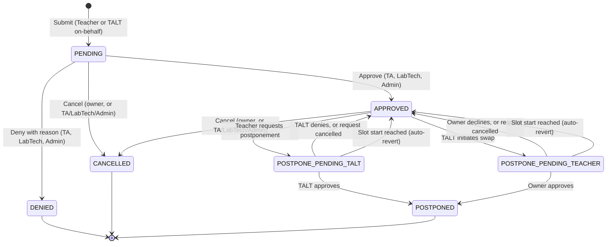
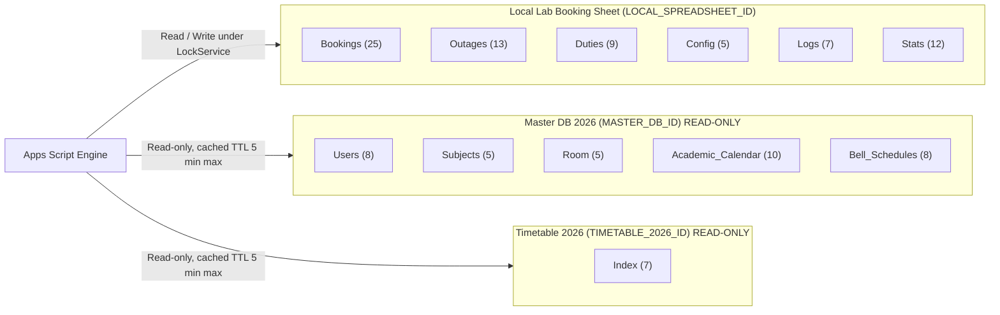
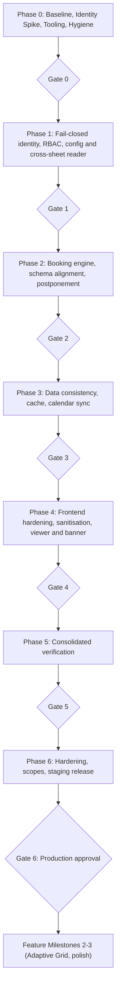

# 📅 Implementation Plan: MUIDS Lab Booking System Security & Functional Remediation (v1.4.0b)

**Target System:** `Lab Oops OS` — Project 01 (`Smart Lab Booking System`)
**Source Location:** `App_Script/` (Google Apps Script web app, 50 files)
**Governing Standard:** `AGENTS.md`, `lab-oops-standards`, `gas-best-practices`, `setup-matt-pocock-skills` (conflicts recorded in [ADR-0002](./adr/0002-superadmin-pin-removal-and-standard-deviations.md))
**Reference Input:** Executive Security Audit (Findings F-01 … F-18, Revisions R-01 … R-16, Owner Decisions through 2026-10-19)
**Companion documents:** [`SCHEMA_CONTRACT.md`](./SCHEMA_CONTRACT.md) · [`PHASE_CHECKLIST.md`](./PHASE_CHECKLIST.md) · [`PHASE_0_IMPLEMENTATION_PLAN.md`](./PHASE_0_IMPLEMENTATION_PLAN.md) · [`PRD_AMENDMENT_v1.4.0b.md`](./PRD_AMENDMENT_v1.4.0b.md) · [`adr/`](./adr/)

> **Status of this document:** a *plan*. No application code has changed yet. `CHANGELOG.md` records planned work under `[Unreleased]` until code ships.

---

## 🔄 Changes From v1.4.0a to v1.4.0b (2026-10-19)

| Change | Where addressed | Decisions / Checklist |
|---|---|---|
| Normalised all tab/column lists across plan, contract, profile, logs; Outages and Duties column order changed; `IsActive` added to `Duties` | Contract §2–§4 | D-05, D-36 · `P2-29` |
| Ownership changed from `TEACHER_EMAIL` to `TargetUserID` (UserID only; nickname and email via `Users`) | §2.1, Phase 1 | D-21 · `P1-20` |
| Status enum fixed to 7 values incl. `DENIED` and `POSTPONED`; PRD/code to follow | §2.2, Contract §6, PRD Amendment | D-22 · `P2-26` |
| Postponement redesigned as linked-row, two-way approval, cancellation in both modes, no timeout (auto-revert at slot start) | §2.2, ADR-0003 | D-04, D-23 · `P2-12`, `P2-25` |
| Cross-sheet reader and **all** ID migration moved to Phase 1 (from P2-03 and P6-01) | Phase 1 | D-13, D-14, D-35 · `P1-17`, `P1-18`, `P1-19` |
| `ALLOWALL` → `DEFAULT` moved to Phase 1 | Phase 1 | D-20 · `P1-23` |
| Client-side admin PIN removed; shortcut only for server-verified Admin/SuperAdmin | §2.7, Phase 1 | D-27, F-18 · `P1-24` |
| SuperAdmin defined as Script Property (ADR-0002) | §2.6 | D-26 · `P1-25` |
| Admin-only impersonation: view-only preview, dry-run "try actions" in production | §2.8 | D-16 · `P1-26` |
| `Student` zero permissions; `HoD` executive read-only | §2.1 | D-08, D-10, D-24 · `P1-21`, `P1-22` |
| Read-only forensic log viewer for all non-student roles | §2.9 | D-25 · `P2-28`, `P4-09` |
| Room + calendar + bell derive bookability; revocation = delete `Users` row; teacher-join audit | Contract §7 | D-29, D-30, D-31 · `P1-27`, `P1-28` |
| Identity spike disqualifiers and process hygiene (tag by SHA, branch protection, scanning, doc lint) | Phase 0 | D-33, D-34 · `P0-11` … `P0-17` |
| Milestones 2–3 (feature work) sequenced after Gate 6 | §6 | D-28 |

---

## 🏛️ 1. Skills & Standards Applied

### 1.1 Inventory Mapping

| Owner Mention | Installed Skill | Exact File Path | Certainty |
|---|---|---|---|
| `"lab-opps-master"` | `lab-oops-standards` | `.agents/skills/lab-oops-standards/SKILL.md` | Certain |
| `"app-script-best-practices"` | `gas-best-practices` | `.agents/skills/gas-best-practices/SKILL.md` | Certain |
| `"matt-pocker"` | `setup-matt-pocock-skills` | `.agents/skills/setup-matt-pocock-skills/SKILL.md` | Certain |

*(Absolute local paths are intentionally omitted from committed documents.)*

### 1.2 Precedence
1. Security findings and Owner decisions override any skill guidance. Every override is recorded in an ADR (see ADR-0002).
2. `lab-oops-standards` governs RBAC, branding, directory layout, mandatory sheets; `gas-best-practices` governs Apps Script execution boundaries; `setup-matt-pocock-skills` governs documentation layout and ADRs.
3. Each rule file cited below must exist at the stated path; the agent verifies this in Phase 0.

### 1.3 Skills Applied per Phase

| Phase | Skill | Rule / Section | How it shapes the work | Checklist |
|---|---|---|---|---|
| 0 | `setup-matt-pocock-skills` | `docs/`, `adr/` layout | Documentation, ADRs, checklist structure | `P0-03`, `P0-04`, `P0-06` |
| 0 | `lab-oops-standards` | §1 Core Developer Context | `Asia/Bangkok`, AY 2026 | `P0-07`, `P0-08` |
| 1 | `lab-oops-standards` | §1 & §13 RBAC | No `"TALT"` role string; canonical roles | `P1-07`, `P1-08`, `P1-09` |
| 1 | `gas-best-practices` | `rules/security.md`, `rules/web-app-rpc.md`, `rules/properties-service.md` | Fail-closed identity; no client identity; Script Properties | `P1-01`, `P1-02`, `P1-10`, `P1-18` |
| 2 | `gas-best-practices` | `rules/lock-service.md`, `rules/spreadsheet-ops.md` | Atomic conflict checks; flush before unlock | `P2-07`, `P2-08`, `P2-09` |
| 2 | `lab-oops-standards` | §4 Database Schemas | Contract alignment (deviations in ADR-0002) | `P2-01`, `P2-02`, `P2-17` |
| 3 | `gas-best-practices` | `rules/cache-service.md`, `rules/data-integrity.md` | Targeted writes; cache TTLs | `P3-01`, `P3-07`, `P3-10` |
| 4 | `gas-best-practices` | `rules/htmlservice-frontend.md`, `rules/error-handling.md` | `sanitizeCell_`; no `innerHTML` interpolation | `P4-01`, `P4-03`, `P4-05` |
| 5 | `setup-matt-pocock-skills` | Issue tracker & verification | Traceability in `TEST_RESULTS.md` | `P5-04`, `P5-05` |
| 6 | `gas-best-practices` | `rules/deployment-versioning.md` | Minimal OAuth scopes; rollback | `P6-03`, `P6-07` |

---

## 🔐 2. Core Architectural Specifications

### 2.1 Canonical Role × Action Matrix (`PERMISSIONS`)

Policy-as-data in `Utils_Security.js`. Gatekeeper, API endpoints, tests and generated docs all read this one table.

```javascript
TALT_STAFF  = ["TA", "LabTech", "Admin"];            // named group; "TALT" is never a stored role string
VALID_ROLES = ["Teacher", "TA", "LabTech", "Admin", "HoD", "Student"];
// SuperAdmin = Script Property SUPERADMIN_EMAILS (not a role). Inherits Admin + diagnostics + impersonation + config.
```

| Action | Teacher | TA | LabTech | Admin | HoD | Student | Source |
|---|:---:|:---:|:---:|:---:|:---:|:---:|:---:|
| `ACTION_SUBMIT_BOOKING` | Own | Own / On-behalf | Own / On-behalf | Any | **Denied** | Denied | D-10 |
| `ACTION_VIEW_OWN_BOOKINGS` | Own | Own | Own | Own | Own (read-only) | Denied | D-24 |
| `ACTION_VIEW_ALL_BOOKINGS` (Master Calendar) | Allowed | Allowed | Allowed | Allowed | Allowed | Denied | D-10 |
| `ACTION_VIEW_SCHEDULE` | Allowed | Allowed | Allowed | Allowed | Allowed | **Denied** | D-08 |
| `ACTION_CANCEL_BOOKING` | Own only (24 h lock) | Any | Any | Any | **Denied** | Denied | D-02, D-24 |
| `ACTION_APPROVE_BOOKING` | Denied | Allowed | Allowed | Allowed | **Denied** | Denied | D-03, D-10 |
| `ACTION_REJECT_BOOKING` (status `DENIED`) | Denied | Allowed | Allowed | Allowed | **Denied** | Denied | D-03, D-10 |
| `ACTION_REQUEST_POSTPONE` | Own (24 h lock) | Any (TALT-initiated swap) | Any (TALT-initiated swap) | Any | **Denied** | Denied | D-04 |
| `ACTION_APPROVE_POSTPONE` | Reciprocal (only TALT-initiated swaps of own bookings) | Allowed | Allowed | Allowed | **Denied** | Denied | D-04 |
| `ACTION_CANCEL_POSTPONE_REQUEST` | Own (requests they started) | Allowed | Allowed | Allowed | Denied | Denied | D-23 |
| `ACTION_ASSIGN_ROOM_TECH` | Denied | Allowed | Allowed | Allowed | Denied | Denied | D-10 |
| `ACTION_MANAGE_OUTAGES` | Denied | Allowed | Allowed | Allowed | Denied | Denied | D-10 |
| `ACTION_EDIT_CONFIG` | Denied | Denied | Denied | Allowed | Denied | Denied | D-10 |
| `ACTION_VIEW_LOGS_STATS` (read-only viewer) | Allowed | Allowed | Allowed | Allowed | Allowed | Denied | D-25 |
| `ACTION_RUN_DIAGNOSTICS` (+ `ENABLE_DIAGNOSTICS`) | Denied | Denied | Denied | Allowed | Denied | Denied | D-10 |
| `ACTION_IMPERSONATE_PREVIEW` | Denied | Denied | Denied | Allowed | Denied | Denied | D-16 |
| `ACTION_TRIGGER_CALENDAR` | Denied | Allowed | Allowed | Allowed | Denied | Denied | D-24 |

*`Source` names the decision that determines the row. Cells not literally quoted by the Owner but implied by a confirmed decision are marked by that decision's ID and are re-verified at Gate 1.*

**Student policy (D-08):** `@student.mahidol.ac.th` and `@student.mahidol.edu` accounts may pass domain validation but **every action is Denied** for the `Student` role until a Student module exists.
**HoD policy (D-10, D-24, D-43):** HoD is strictly executive read-only: cannot book, cannot act as proxy, and **cannot be the `TargetUserID` of an on-behalf booking**. Any booking attempt targeting an HoD fails with `TARGET_ROLE_INELIGIBLE`. The earlier workaround permitting proxy booking for an HoD is completely withdrawn (D-43).
**Error taxonomy:** every permission, role, domain, ownership or identity failure throws `AUTH_DENIED` (the reason code is written to `Logs` only). Business-rule failures (lead time, conflicts) use their own codes.

#### Booking Ownership & Audit Attribution (D-21, D-11)
- **Owner:** `Bookings.TargetUserID` (a **UserID only**). The caller's email is resolved through `Users` to a `UserID` and compared. No ownership check uses an email column.
- **On-behalf bookings:** `SubmittedByUserID` = TALT operator, `TargetUserID` = teacher owner, `ConfirmUserId` = approver, `AssignedTaltID` = assigned technician(s). The teacher keeps cancellation and postponement rights.

---

### 2.2 Booking Lifecycle & Postponement State Machine (D-22, D-23, ADR-0003)



**Stored status values (exact):** `PENDING`, `APPROVED`, `DENIED`, `CANCELLED`, `POSTPONE_PENDING_TALT`, `POSTPONE_PENDING_TEACHER`, `POSTPONED`.

**Rules**
1. **Blocking:** `PENDING`, `APPROVED`, `POSTPONE_PENDING_TALT` and `POSTPONE_PENDING_TEACHER` occupy their slot. Conflict checks read live data inside the lock.
2. **Linked-row postponement:** a request keeps the original row `O` and inserts a proposed-slot row `N` with the same pending status and `LinkedBookingID = O.BookingID` (both slots blocked). Approval sets `N` → `APPROVED` and `O` → `POSTPONED` in one lock. Denial or cancellation sets `N` → `CANCELLED` and `O` → `APPROVED`.
3. **Cancellation in both modes:** the initiator or any `TA`/`LabTech`/`Admin` may cancel a pending request. **No timeout** exists. Safety invariant: when the earlier of the two slot start times is reached while pending, the request auto-reverts and `POSTPONE_AUTO_REVERT` is logged.
4. **Denial reasons** are appended to `Remark` (chronological ascending, never overwritten) on every row involved.
5. **Locks:** teachers cannot cancel or request postponement within 24 h of the slot start. TALT bypass is allowed with `[URGENT_BYPASS …]` audit logging. A TALT-initiated swap still requires the owner's approval.
6. **Atomicity:** every transition above runs inside a single `LockService` critical section followed by `SpreadsheetApp.flush()`.
7. **Calendar:** approval removes the event of `O` and creates the event of `N`; cancellation removes events of pending rows.

---

### 2.3 Cross-Sheet Federated Data Architecture (12 consumed tabs across 3 spreadsheets)



**Authoritative headers:** see [`SCHEMA_CONTRACT.md`](./SCHEMA_CONTRACT.md) (single source of truth; counts in all documents must match it). Tabs not consumed by the app (Master DB `Global_Config`, `Config`, `Logs`; Timetable `TimeTable 2026`, `Template`, per-teacher pages, `Config`, `Logs`) are documented there for completeness only.

**Rules**
- **Read-only external sheets:** Viewer permission for the deploying account; static check forbids writes (`P2-04`).
- **Federated cache keys:** `spreadsheetId + ":" + tabName`; role/directory TTL ≤ 300 s (D-12); directory data in `CacheService` only, never in Script Properties.
- **Fail closed:** Master DB unreachable or a required header missing → authorization denies; schedule reads return a clear error, never defaults.
- **Bookable slot (D-29):** Room exists ∧ date is instructional ∧ period exists for the effective bell type ∧ no active outage ∧ no occupying booking (see Contract §7.1).
- **Revocation (D-30):** delete the user's row in Master DB `Users`; access ends within 5 minutes. `UserID` must be stable and never reused (audit `P1-27`).
- **Teacher join (D-15, D-31):** `Session email → Users.DisplayName → Index.Teacher`; zero or multiple matches throw `TIMETABLE_USER_UNRESOLVED`; one-time audit `P1-28`.
- **Interface seam:** all role and directory reads go through `getUserDirectory_()` so tests can stub it.

---

### 2.4 Lead Time, 24-Hour Cancellation Lock & Urgent Bypass (D-07)

- **Advance booking lead time:** **2 instructional school days**, evaluated against `Academic_Calendar.IsInstructional` (skips weekends, holidays, breaks).
- **Cancellation & postponement lock:** teachers cannot cancel or request postponement within **24 hours** of the slot start (`Asia/Bangkok`).
- **TALT bypass:** `TA`, `LabTech` and `Admin` may bypass both rules for any action, with a mandatory justification.
- **Audit:** `Remark` gets `[URGENT_BYPASS <YYYY-MM-DD HH:mm> by <Nickname>]: <justification>`; `Logs` gets `URGENT_BOOKING_BYPASS` with the teacher's UserID, subject, operator UserID and justification; `Stats.UrgentBypassCount` increments.

### 2.5 Deployment Topology (D-20, D-06, D-33)

- **Standalone Web App URL only.** Not embedded in Google Sites. `XFrameOptionsMode.DEFAULT` everywhere; `ALLOWALL` is prohibited and is removed in **Phase 1** (`P1-23`).
- **Execution model is decided by the Phase 0 Identity Spike, not pre-decided.** The spike applies explicit **disqualifiers** (Phase 0, workstream 0.3). Expected outcome: `USER_DEPLOYING` with `access: DOMAIN` for staff. Student-domain access is best-effort and must not drive the model.

### 2.6 SuperAdmin (D-26, ADR-0002)
- Script Property `SUPERADMIN_EMAILS` (comma-separated, normalised). Applies only to a **resolved**, whitelisted active user. An unresolved identity is never mapped to SuperAdmin.
- Inherits all `Admin` rights plus diagnostics, impersonation and configuration editing.
- **Break-glass:** if Master DB is unreachable, a resolved SuperAdmin may open the diagnostics/health view only; no booking operations.

### 2.7 Client-Side Admin PIN Removed (D-27, F-18)
No PIN check, PIN label or PIN text may remain in code or docs. The `Ctrl + Shift + Q` shortcut remains only as a UI convenience: it reveals the admin panel for a session the **server** verified as `Admin` or SuperAdmin. Every action behind it is authorised server-side.

### 2.8 Admin Impersonation — "Act as user" (D-16)
- Allowed for `Admin` and SuperAdmin only; the target must be a non-admin user (no impersonating `Admin`/SuperAdmin).
- State is held **server-side** (keyed to the admin's session, with a short TTL), never as a client-supplied header.
- **Production:** read-only preview; "try actions" executes as a **dry-run** (full validation, result returned, nothing written). **DEV sheet only:** real writes are permitted.
- Every action is logged with the **real admin** as `User ID` and `[IMPERSONATING <UserID>]` in the message; a visible banner is shown (Phase 4 UI).

### 2.9 Forensic Log Viewer (D-25)
All roles except `Student` can open a **read-only** viewer showing event details and actor emails. The server exposes only a read endpoint (no write path); the response uses an allowlist of columns, sanitised message text (no stack traces, tokens or payloads) and pagination. The UI contains no editable controls.

---

## 🚀 3. Phase-Based Roadmap



**Rule:** one phase at a time. Each phase ends at a gate with an evidence pack; the next phase starts only after owner approval.

---

### Phase 0 — Baseline, Safety, Identity Spike, Tooling & Repository Hygiene
*Details in [`PHASE_0_IMPLEMENTATION_PLAN.md`](./PHASE_0_IMPLEMENTATION_PLAN.md).*
* **Findings / revisions:** baseline for F-01 … F-18, R-01, R-06, R-10, R-16, D-33, D-34.
* **Workstreams:** (1) git isolation with a rollback tag **by explicit SHA**; (2) pattern-based secret/ID scan and branch protection; (3) **Identity Spike** with pre-registered disqualifiers and redacted evidence; (4) Node test harness; (5) `verify_phase.js`; (6) ledger and exposure matrix; (7) `Health_UAT.js` fixture sanitation; (8) owner-run read-only header dump to verify the contract; (9) docs lint.
**Account Coverage Matrix & Scope (D-44):**
| Account Category | Role / Identity Used | Scope / What It Proves | What It Cannot Prove |
|---|---|---|---|
| Staff (`@mahidol.ac.th`) | Owner staff account (`Admin` in Master DB `Users`) | Tests Admin identity resolution and permissions **strictly against DEV copies**. | Does not test non-Admin staff roles without extra accounts. |
| Consumer Google Account | Owner personal account | Serves as non-Workspace negative control (`AUTH_DENIED` by domain whitelist) and proxy for Microsoft-hosted G10 accounts. | Cannot validate student domain whitelisting (tested via unit tests). |
| Workspace Student (`@student.mahidol.edu`) | Dedicated test account (if available) | Tests legacy Google Workspace student domain behavior. | Remains **unverified / best-effort** until dedicated test account exists. |
| Teacher / TA / LabTech | Unit stubs & Admin preview-impersonation | Validates permission logic, state transitions, and read-only preview. | Live multi-user concurrency on staging (validated at Phase 5). |

> **Prerequisite (D-44 / P0-18):** Isolated DEV copies of Master DB 2026 and Timetable 2026 must be configured before running tests; the production Master DB is **never modified**.

* **DoD:** `docs/IDENTITY_DECISION.md` approved; `node scripts/verify_phase.js --phase 0` exits 0; zero application logic changed except fixture sanitation.
* **Gate 0:** STOP.

### Phase 1 — Authentication, Fail-Closed Identity, RBAC, Configuration & Cross-Sheet Reader
* **Findings:** `F-01`, `F-02`, `F-03`, `F-04` (containment), `F-10`, `F-13` (framing), `F-14` (IDs), `F-18`, `R-02`, `R-03`, `R-07`, `R-08`, D-08, D-10, D-13, D-14, D-16, D-20, D-21, D-24 … D-27, D-30, D-31, D-35.
* **Workstreams:**
  1. **Fail-closed gatekeeper** (`Utils_Security.js`, `API_Bridge.js`): `enforcePerimeterSecurityGatekeeper(action, targetBooking)` throws `AUTH_DENIED` on any failure; identity only from `Session.getActiveUser()`; remove `getEffectiveUser` fallback, the hardcoded superadmin fallback and the `DEV_MOCK_USER_EMAIL` path entirely.
  2. **Domain whitelist:** exact match on the three domains; look-alike and `@mahidol.edu` rejected; a **pre-enforcement audit** reports counts (no PII) of `Users` rows outside the whitelist.
  3. **Configuration & ID migration (moved from P2-03/P6-01):** `Utils_Config.get(key)` over Script Properties. Move the local, DEV, Master DB, Timetable and Calendar IDs and `SUPERADMIN_EMAILS` out of source. `getMainSpreadsheet()` throws `DATABASE_UNAVAILABLE` and `FALLBACK_SHEET_ID` is deleted. Tests and diagnostics refuse the production ID (D-14).
  4. **Cross-sheet reader (moved from P2-03):** `getUserDirectory_()` over Master DB `Users` with federated cache keys, TTL ≤ 300 s, header validation, email → `UserID` resolution.
  5. **PERMISSIONS enforcement:** matrix in §2.1; ownership by `TargetUserID`; `Student` all denied; `HoD` read-only; `TA` ≡ `LabTech`.
  6. **Function exposure & read-API scoping:** internal functions renamed with `_`; explicit public allowlist; read APIs authenticated and scoped (teachers receive only what the matrix allows).
  7. **Framing & PIN:** replace `ALLOWALL` with `DEFAULT` in all three places in `Main.js`; remove the PIN gateway from `Index.html`; shortcut only for server-verified Admin/SuperAdmin; fix `Main.doGet` admin-route check.
  8. **SuperAdmin & break-glass** (§2.6) and **server-side impersonation** (§2.8). UI banner arrives in Phase 4.
  9. **Diagnostics containment:** admin-only and `ENABLE_DIAGNOSTICS` (default `false`).
  10. **Audits (owner-run, read-only):** `UserID` stability (`P1-27`) and the one-time **teacher-join audit** (`P1-28`), counts reported without PII.
* **DoD:** full authorization matrix unit tests (6 roles × actions × ownership); look-alike domain tests; `AUTH_DENIED` taxonomy tests; zero hardcoded IDs; zero `ALLOWALL`; zero PIN text; `verify_phase.js --phase 1` exits 0.
* **Gate 1:** STOP — owner confirms the matrix and the audit results.

### Phase 2 — Booking Transaction Engine & Schema Alignment
* **Findings:** `F-05`, `F-08`, `F-09`, `F-15`, `F-16`, `R-04`, `R-05`, `R-09`, `R-11`, `R-12`, D-04, D-07, D-19, D-21 … D-23, D-25, D-29, D-36.
* **Workstreams:**
  1. **Schema alignment:** align `TX_COL`, `USR_COL`, `LOG_COL` and `Stats` schemas (case-insensitive headers, throw on mismatch; Outages and Duties order/`IsActive` per D-36, D-39).
  2. **Wiring repair:** wire `coreApproveBooking`/`coreRejectBooking`/`coreCancelBooking` with server identity; fix dropped `session`; fix email-template keys; eliminate "cart" terminology.
  3. **Atomic validation inside the lock:** UUIDs, bookable-slot rule (§2.3, D-37 default `BellType`, D-38 all rooms bookable with `isRoomEligible_` seam), target role validation (`TARGET_ROLE_INELIGIBLE` per D-43), 2-instructional-day lead time, 24-hour lock, TALT bypass audit, `SetupHold` outages, conflicts, `flush()` before unlock.
  4. **Idempotency:** client request ID in `CacheService` (6 h TTL) + natural-key collision prevention.
  5. **Status enum & migration:** enforce 7 stored values incl. `DENIED` and `POSTPONED`; chronological `Remark` stacking; execute legacy status migration procedure (D-42 / `P2-32`).
  6. **Linked-row postponement:** two-way approval with cancellation in both modes and auto-revert (§2.2, ADR-0003).
  7. **Calendar failure marker:** enforce `GCalEventID = ERROR:<code>` vocabulary (D-40); track retries outside sheet schema.
  8. **Canonical teacher join:** resolve session email → nickname → timetable index with `TIMETABLE_USER_UNRESOLVED` fail-closed.
  9. **Forensic log endpoint:** read-only viewer endpoint (§2.9).
* **Behaviour preservation:** before changing the engine, add characterisation tests from PRD §7/§14 (workload limits and bypass, P2 split, short-lab, batch atomicity, outage auto-cancel, calendar guests, lock-busy message).
* **DoD:** submit → approve → deny → cancel → postpone cycle works on staging; concurrency collision test passes; header mismatch throws; `verify_phase.js --phase 2` exits 0.
* **Gate 2:** STOP.

### Phase 3 — Data Consistency, Cache Tier & Calendar Sync
* **Findings:** `F-11`, `F-12`, `R-13`, `R-14`.
* Targeted cell writes; calendar duplicate lookup, immediate `GCalEventID` persistence (`ERROR:<code>` convention), retry with backoff, deletion on cancel and on postponement approval; native Date handling; Layer-2 cache TTL and versioning; `clearAllCaches` fix; scheduled job for postponement auto-revert; cache never authoritative for conflicts.
* **Gate 3:** STOP.

### Phase 4 — Frontend Hardening, Formula Neutralisation & Diagnostics Isolation
* **Findings:** `F-06`, `F-07`, `F-04` (full), D-16 (banner), D-25 (viewer UI).
* `sanitizeCell_` on all writes; remove `innerHTML` interpolation; escape email placeholders; UAT cannot touch production; no function-by-name routing; **impersonation banner**; **read-only log viewer UI** with no editable controls.
* **Gate 4:** STOP.

### Phase 5 — Consolidated Verification
* Static sweeps, full authorization suite, concurrency tests (state evidence level honestly), documentation-consistency lint (tab counts, status enum, no `TEACHER_EMAIL`), traceability in `docs/TEST_RESULTS.md`.
* **Gate 5:** STOP.

### Phase 6 — Hardening, Scopes & Staging Release
* **Findings:** `F-13` (scopes), `F-14` (history scan), `F-17`, `R-15`, `R-16`.
* Minimal explicit OAuth scopes (including the identity scope; test on staging); history scan report; remove dead code and misleading headers; `Result<T>` envelope verification; `CONFIGURATION.md` and `DEPLOYMENT_ROLLBACK.md`; regression guard for IDs and framing; staging smoke test.
* **Gate 6:** final human authorisation for production.

---

## ⚙️ 4. Automated Verification System

### 4.1 `scripts/verify_phase.js` — `node scripts/verify_phase.js --phase <N>`
Read-only, offline Node script. It checks that required files and symbols exist, runs forbidden-pattern sweeps, runs the unit tests, validates `PHASE_CHECKLIST.md` (no unfinished required row; no ☑ without evidence), compares the diff to the planned files (scope creep) and checks documentation consistency. Exit code `0` = pass.

Examples of forbidden patterns: `getEffectiveUser` in the identity path; `DEV_MOCK_USER_EMAIL`; `typeof withLock`; `Math.random` IDs; `ALLOWALL`; PIN text; `TEACHER_EMAIL` in ownership logic; `file:///` or `C:\` in docs; any 44-character Google ID literal; tab counts that disagree with the contract.

### 4.2 Exit-Gate Evidence Pack
1. Summary. 2. `verify_phase` output. 3. Test logs labelled `static` / `unit` / `staging` / `production`. 4. Filled checklist section with commit SHAs. 5. Diff summary versus planned files. 6. Ledger delta. 7. Open owner decisions.

### 4.3 Anti-gaming
Loosening a check, deleting a test or marking a row `⊘` requires a ledger entry and owner approval. Checklist IDs are never reused; moved rows keep their ID and point to the new row.

---

## 📝 5. Decision Ledger

Status: `CONFIRMED` = stated by the Owner; `DERIVED` = follows directly from a confirmed decision; `ASSUMED` = agent inference awaiting confirmation.

| ID | Topic | Specification | Status | Source |
|---|---|---|:---:|---|
| D-01 | Domain whitelist | Exactly `@mahidol.ac.th`, `@student.mahidol.ac.th`, `@student.mahidol.edu`; `@mahidol.edu` prohibited | CONFIRMED | Owner 2026-10-11 |
| D-02 | Teacher cancellation | Teachers cancel/postpone only their own bookings | CONFIRMED | Owner 2026-10-11 |
| D-03 | TA equality | `TA` has the same authority as `LabTech` | CONFIRMED | Owner 2026-10-11 |
| D-04 | Postponement approval | Two-way approval (TALT-initiated → owner approves; teacher-initiated → TALT approves) | CONFIRMED | Owner 2026-10-11 |
| D-05 | Federated data | 3 spreadsheets, 12 consumed tabs (6 local, 5 Master DB, 1 Timetable); non-consumed tabs documented | CONFIRMED | Owner 2026-10-15, 2026-10-19 |
| D-06 | Identity spike | Phase 0 spike decides execution model across the domains | CONFIRMED | Owner 2026-10-11 |
| D-07 | Lead time & lock | 2 instructional days via `Academic_Calendar`; 24 h cancel/postpone lock; TALT bypass audited | CONFIRMED | Owner 2026-10-15 |
| D-08 | Student role | Perimeter pass only; **zero** permissions | CONFIRMED | Owner 2026-10-19 |
| D-09 | Repo privacy | Repository stays public; no real IDs/emails/PIN in committed docs | CONFIRMED | Owner 2026-10-11 |
| D-10 | Role matrix | Admin approves; HoD cannot; Admin/TALT assign technicians, override rooms, manage outages; Admin edits config | CONFIRMED | Owner 2026-10-15, 2026-10-19 |
| D-11 | On-behalf attribution | `SubmittedByUserID`, `TargetUserID`, `ConfirmUserId`, `AssignedTaltID` recorded | CONFIRMED | Owner 2026-10-15 |
| D-12 | Role cache TTL | ≤ 5 minutes | CONFIRMED | Owner 2026-10-15 |
| D-13 | Fail-closed DB | No silent fallback; `DATABASE_UNAVAILABLE`; `FALLBACK_SHEET_ID` removed | CONFIRMED | Owner 2026-10-15 |
| D-14 | DEV/PROD isolation | Separate DEV and PROD IDs, read from Script Properties; tests refuse PROD | CONFIRMED | Owner 2026-10-15 |
| D-15 | Teacher join | Session email → `Users.DisplayName` → `Index.Teacher`; unresolved fails closed | CONFIRMED | Owner 2026-10-15 |
| D-16 | Impersonation | Admin/SuperAdmin only; production = preview + dry-run; writes only on DEV | CONFIRMED | Owner 2026-10-19 |
| D-17 | Test fixtures | Use `uat_tester@mahidol.ac.th` | CONFIRMED | Owner 2026-10-15 |
| D-18 | Derived attributes | `isHoD`, `Can_Edit_Config` derived; tutorial in `localStorage`; `PrimaryGrade` removed | CONFIRMED | Owner 2026-10-15 |
| D-19 | Remarks | Append-only chronological stack | CONFIRMED | Owner 2026-10-15 |
| D-20 | Deployment | Standalone URL; `DEFAULT` framing; fix in Phase 1 | CONFIRMED | Owner 2026-10-15, 2026-10-19 |
| D-21 | Ownership | `TargetUserID` holds UserID only; nickname/email via `Users` | CONFIRMED | Owner 2026-10-19 |
| D-22 | Status enum | `PENDING`, `APPROVED`, `DENIED`, `CANCELLED`, `POSTPONE_PENDING_TALT`, `POSTPONE_PENDING_TEACHER`, `POSTPONED`; plan, contract, PRD amendment, code | CONFIRMED | Owner 2026-10-19 |
| D-23 | Postponement model | Linked-row; cancellation in both modes; no timeout; auto-revert at slot start | CONFIRMED | Owner 2026-10-19 (accepted recommendation) |
| D-24 | HoD | Executive read-only | CONFIRMED | Owner 2026-10-19 |
| D-25 | Forensic viewer | Read-only for all non-student roles, with event details and emails | CONFIRMED | Owner 2026-10-19 |
| D-26 | SuperAdmin | Script Property list; never a fallback (ADR-0002) | CONFIRMED | Owner 2026-10-19 |
| D-27 | Admin PIN | Removed | CONFIRMED | Owner 2026-10-19 |
| D-28 | Feature sequencing | Milestones 2–3 after Gate 6; Outages schema already live | CONFIRMED | Owner 2026-10-19 |
| D-29 | Bookable rule | Room + calendar + bell (+ outages + live bookings) | CONFIRMED | Owner 2026-10-19 |
| D-30 | Revocation | Delete the `Users` row; stable, never-reused `UserID` | CONFIRMED / ASSUMED (stability audit) | Owner 2026-10-19 |
| D-31 | Teacher-join audit | One-time audit; each `Index.Teacher` resolves to exactly one user | CONFIRMED | Owner 2026-10-19 |
| D-32 | Not-consumed tabs | Documented only | CONFIRMED | Owner 2026-10-19 |
| D-33 | Spike disqualifiers | See Phase 0 §0.3 | CONFIRMED | Owner 2026-10-19 |
| D-34 | Process hygiene | Tag by SHA; branch protection; scanning; relative links; single schema source; `[Unreleased]` changelog | CONFIRMED | Owner 2026-10-19 |
| D-35 | Phase moves | Reader and all ID migration → Phase 1 | CONFIRMED | Owner 2026-10-19 |
| D-36 | Column order | Outages and Duties per contract; `Duties.IsActive` added | CONFIRMED | Owner 2026-10-19 |
| D-37 | Default `BellType` | When `Academic_Calendar.BellScheduleOverride` is blank, effective `BellType` is `Wed` if `DayOfWeek` is Wednesday, otherwise `Regular` | CONFIRMED (rule); ASSUMED (spelling) | Owner 2026-10-19 |
| D-38 | Room scope | All `Room` rows are bookable; no `RoomType` filter. Timetable verification retained; future restrictions deferred to BL-01 via `isRoomEligible_` seam | CONFIRMED | Owner 2026-10-19 |
| D-39 | Live spellings | Exact tab spelling is `Bookings`; header is `IsActive`. Matching remains trim + case-insensitive | CONFIRMED | Owner 2026-10-19 |
| D-40 | Calendar failure marker | Failed sync recorded as `GCalEventID = ERROR:<code>` with standard code vocabulary; retry attempts tracked outside sheet schema | CONFIRMED (marker); ASSUMED (codes/retry) | Owner 2026-10-19 |
| D-41 | Non-statuses | `Action Required` and `Error (Calendar)` are non-statuses; recorded in `Remark` and `Logs` only | CONFIRMED | Owner 2026-10-19 |
| D-42 | Status migration | Migrate legacy statuses using PRD amendment §2 mapping (backup copy, DEV first, idempotent, counts only, unknown strings block go-live) | CONFIRMED | Owner 2026-10-19 |
| D-43 | HoD restriction | HoD is strictly read-only: cannot book, cannot proxy, and cannot be `TargetUserID` of on-behalf booking (`TARGET_ROLE_INELIGIBLE`); workaround withdrawn | CONFIRMED (interpretation to reconfirm) | Owner 2026-10-19 |
| D-44 | Test account policy | Admin on DEV via staff account; consumer Google proxy for G10; Workspace student best-effort; no emails in committed docs; DEV DB prerequisite | CONFIRMED | Owner 2026-10-19 |
| D-45 | ADR-0002 reconfirmed | SuperAdmin via Script Property, PIN removal, project schema authority, global standards updated later | CONFIRMED | Owner 2026-10-19 |

---

## 🔓 6. Sequencing of Feature Work (D-28)
Feature Milestones 2–3 (Adaptive Calendar Grid, SetupHold modal, pre-release polish) start **after Gate 6** to avoid concurrent edits to the same files. The `Outages` columns are already in the contract, so `SetupHold` enforcement is delivered in Phase 2 (`P2-11`); only its UI waits.

## ❓ 7. Open Items for the Owner
1. Default `BellType` when `BellScheduleOverride` is blank (Contract O-1).
2. Whether `Room` contains non-lab rooms (Contract O-5).
3. Live header verification and array-formula check (`P0-17`).
4. Migration of any existing rows that use legacy status strings.
5. Exact header spelling `IsActive` and tab name `Bookings` (case-insensitive matching covers casing).
