# 🛡️ Phase 0 Implementation Plan: Baseline, Safety, Identity Spike & Verification Tooling

**Target System:** `Lab Oops OS` — Project 01 (`Smart Lab Booking System`)  
**Version Target:** `v1.4.0a`  
**Governing Documents:** [`docs/IMPLEMENTATION_PLAN.md`](file:///c:/Users/MUIDS/Documents/Projects/Lab%20Oops/Project01_LabBooking/docs/IMPLEMENTATION_PLAN.md), [`docs/PHASE_CHECKLIST.md`](file:///c:/Users/MUIDS/Documents/Projects/Lab%20Oops/Project01_LabBooking/docs/PHASE_CHECKLIST.md), [`AGENTS.md`](file:///c:/Users/MUIDS/Documents/Projects/Lab%20Oops/Project01_LabBooking/AGENTS.md)  
**Execution Mode:** Pure Foundation, Tooling, Staging Spike & Safety Isolation (Zero modifications to production `App_Script/` application logic)

---

## 📌 1. Executive Summary & Purpose

Phase 0 establishes the engineering, safety, and verification foundation for the entire `v1.4.0a` production hardening initiative. 

### Why Phase 0 is Critical:
The MUIDS Lab Booking System currently contains 17 identified security vulnerabilities and architectural gaps (`F-01` through `F-17`), ranging from client-controlled authorization to full-spreadsheet overwrite risks. Attempting to modify core application logic without:
1. An isolated rollback git baseline,
2. Empirical proof of caller identity resolution across MUIDS's 3 Google Workspace domains via a staging spike,
3. An offline automated test harness simulating Google Apps Script services, and
4. An automated phase verification runner enforcing anti-scope-creep and evidence-backed checklists,
would introduce severe regression and data corruption risks.

Phase 0 resolves all prerequisites **offline and in staging**, leaving the production codebase untouched while arming developers and AI auditing agents with verification tooling.

---

## 🎯 2. Phase 0 Objectives & Scope

| Objective | Target Artifact / Deliverable | Verification Tool |
|---|---|---|
| **Git Isolation & Rollback** | Working branch `security/production-hardening` & git tag `pre-hardening-baseline` | `git branch`, `git tag` |
| **Secret & ID Hygiene** | Complete scan report of committed IDs across history; verification of placeholders | `git log -S`, `git grep` |
| **Staging Identity Spike** | Deploy probe to staging; empirically verify `USER_DEPLOYING` vs `USER_ACCESSING` across 3 domains | [`docs/IDENTITY_DECISION.md`](file:///c:/Users/MUIDS/Documents/Projects/Lab%20Oops/Project01_LabBooking/docs/IDENTITY_DECISION.md) |
| **Test Environment Harness** | Pure Node.js Gas stubs (`Session`, `SpreadsheetApp`, `LockService`, `CacheService`, `PropertiesService`) | `node test/run_tests.js` |
| **Verification Runner** | CLI verification engine (`scripts/verify_phase.js`) enforcing AST checks & checklist status | `node scripts/verify_phase.js --phase 0` |
| **Living Security Audit Ledger** | Detailed classification of `F-01` through `F-17` with threat modeling & diff anchors | [`docs/SECURITY_AUDIT.md`](file:///c:/Users/MUIDS/Documents/Projects/Lab%20Oops/Project01_LabBooking/docs/SECURITY_AUDIT.md) |
| **Call Graph & Surface Map** | Complete inventory and categorization of all 50 `App_Script/` files | [`docs/ACCESS_CONTROL_MATRIX.md`](file:///c:/Users/MUIDS/Documents/Projects/Lab%20Oops/Project01_LabBooking/docs/ACCESS_CONTROL_MATRIX.md) |
| **Test Fixture Sanitation** | Refactor all test fixtures in `Health_UAT.js` from `@mahidol.edu` to `uat_tester@mahidol.ac.th` | `git grep "@mahidol.edu"` |

---

## 🛠️ 3. Detailed Workstream Execution Breakdown

```mermaid
flowchart TD
    subgraph W1["Workstream 0.1: Git Isolation"]
        W1_1["Clean baseline check (commit b984891)"] --> W1_2["Create branch 'security/production-hardening'"]
        W1_2 --> W1_3["Create annotated tag 'pre-hardening-baseline'"]
    end

    subgraph W2["Workstream 0.2: Secret Hygiene"]
        W2_1["Scan git log for exposed IDs"] --> W2_2["Verify docs use placeholders"]
        W2_2 --> W2_3["Deliver hygiene report in SECURITY_AUDIT.md"]
    end

    subgraph W3["Workstream 0.3: Identity Spike (CRITICAL)"]
        W3_1["Author probe endpoint (probe_identity.js)"] --> W3_2["Deploy to Staging Apps Script"]
        W3_2 --> W3_3["Test Staff (@mahidol.ac.th)"]
        W3_2 --> W3_4["Test G10 (@student.mahidol.ac.th)"]
        W3_2 --> W3_5["Test G11/G12 (@student.mahidol.edu)"]
        W3_2 --> W3_6["Test External (@gmail.com)"]
        W3_3 & W3_4 & W3_5 & W3_6 --> W3_7["Compile docs/IDENTITY_DECISION.md"]
    end

    subgraph W4["Workstream 0.4: Test Harness"]
        W4_1["Implement gas-stubs.js"] --> W4_2["Implement test/run_tests.js"]
        W4_2 --> W4_3["Verify offline stub execution"]
    end

    subgraph W5["Workstream 0.5: Automated Runner"]
        W5_1["Scaffold scripts/verify_phase.js"] --> W5_2["Implement AST/regex static checks"]
        W5_2 --> W5_3["Implement checklist parser & git diff analyzer"]
    end

    subgraph W6["Workstream 0.6 & 0.7: Ledgers & Call Graphs"]
        W6_1["Author docs/SECURITY_AUDIT.md"]
        W6_2["Author docs/ACCESS_CONTROL_MATRIX.md"]
    end

    subgraph W8["Workstream 0.8: Test Sanitation"]
        W8_1["Sanitize Health_UAT.js to @mahidol.ac.th"]
    end

    W1 --> G0{"Gate 0 Exit Review"}
    W2 --> G0
    W3 --> G0
    W4 --> G0
    W5 --> G0
    W6 --> G0
    W8 --> G0
```



---

### Workstream 0.1: Git Isolation & Rollback Anchoring (`P0-01`, `P0-02`)
* **Objective:** Ensure all changes occur on an isolated feature branch and establish an unalterable rollback tag.
* **Commands to Propose & Execute:**
  ```powershell
  git checkout -b security/production-hardening
  git tag -a pre-hardening-baseline -m "Baseline commit prior to v1.4.0a production hardening remediation"
  ```
* **Success Criteria:**
  - `git branch --show-current` returns `security/production-hardening`.
  - `git tag -l "pre-hardening-baseline"` confirms tag existence pointing to clean baseline `b984891`.

---

### Workstream 0.2: Public Repo Secret Hygiene & ID Scrubbing (`P0-07`, `D-09`)
* **Objective:** Maintain the repository as public for external AI agent auditing while guaranteeing that zero operational secrets or private spreadsheet IDs exist in committed files.
* **Execution Steps:**
  1. Audit git history for historical leaks:
     ```powershell
     git log -S "<LOCAL_SPREADSHEET_ID>" --oneline
     ```
  2. Verify all references in `docs/` use standard placeholders:
     - `<LOCAL_SPREADSHEET_ID>`
     - `<DEV_SPREADSHEET_ID>`
     - `<MASTER_DB_ID>`
     - `<TIMETABLE_2026_ID>`
     - `<CALENDAR_ID>`
  3. Include a formal Secret Exposure Ledger in `docs/SECURITY_AUDIT.md`.

---

### Workstream 0.3: Staging Identity Spike Protocol (`P0-08`, `R-01`, `D-06`) — *CRITICAL GATEWAY*
* **Context & Problem Statement:**
  MUIDS accounts are split across three distinct domains:
  - Faculty/Staff: `@mahidol.ac.th`
  - Grade 10 Students: `@student.mahidol.ac.th` (Uses Microsoft Outlook for email; does **not** have Gmail, but holds a Google Workspace identity for Classroom/Drive).
  - Grades 11 & 12 Students: `@student.mahidol.edu` (Standard Google Workspace account with Gmail).
  
  Apps Script `Session.getActiveUser().getEmail()` behaves differently depending on whether the script execution mode in `appsscript.json` is set to:
  - `USER_DEPLOYING` (Run as developer): Often returns an empty string `""` for non-deployer callers unless specific organization sharing constraints are met.
  - `USER_ACCESSING` (Run as user accessing web app): Returns the caller's email directly, but requires each user to grant OAuth consent and possess read/write permissions to underlying sheets.

* **Spike Probe Script (`test/probe_identity.js` / Staging Web App):**
  A standalone staging endpoint deployed to test:
  ```javascript
  function doGet(e) {
    var activeUser = Session.getActiveUser().getEmail();
    var effectiveUser = Session.getEffectiveUser().getEmail();
    var authMode = ScriptApp.getAuthMode();
    
    var payload = {
      timestamp: new Date().toISOString(),
      activeUserEmail: activeUser,
      effectiveUserEmail: effectiveUser,
      authMode: String(authMode),
      userAgent: e.parameter.ua || "unknown",
      queryParamEmail: e.parameter.email || null,
      headers: e
    };
    
    return ContentService.createTextOutput(JSON.stringify(payload, null, 2))
      .setMimeType(ContentService.MimeType.JSON);
  }
  ```

* **Test Execution Matrix:**
  | Test Case ID | Test Account Domain | Account Type | Expected `activeUser` (USER_ACCESSING) | Expected `activeUser` (USER_DEPLOYING) |
  |---|---|---|:---:|:---:|
  | `SPIKE-01` | `user@mahidol.ac.th` | Staff (Full Google Workspace) | `user@mahidol.ac.th` | Verified in Spike |
  | `SPIKE-02` | `user@student.mahidol.ac.th` | G10 Student (Google Identity, Outlook Mail) | `user@student.mahidol.ac.th` | Verified in Spike |
  | `SPIKE-03` | `user@student.mahidol.edu` | G11/G12 Student (Full Google Workspace) | `user@student.mahidol.edu` | Verified in Spike |
  | `SPIKE-04` | `user@gmail.com` | External Consumer Gmail | `AUTH_DENIED` | `AUTH_DENIED` |

* **Deliverable:** [`docs/IDENTITY_DECISION.md`](file:///c:/Users/MUIDS/Documents/Projects/Lab%20Oops/Project01_LabBooking/docs/IDENTITY_DECISION.md) containing the empirical findings, session header behaviors, and the binding architectural decision on execution mode. **Phase 1 cannot begin until this document is approved.**

---

### Workstream 0.4: Pure Node.js Test Harness & Gas Stubs (`P0-05`, `R-10`)
* **Objective:** Enable high-speed, 100% offline unit testing for authorization matrices, collision detection, and schema validation without making calls to Google servers.
* **Component Design (`test/gas-stubs.js` & `test/run_tests.js`):**
  - **`MockSession`:** Tracks mock caller session email; supports switching active caller on the fly (`setActiveUser(email)`).
  - **`MockSpreadsheetApp`:** Maintains virtual in-memory sheets populated from fixtures; tracks `flush()` calls and row ranges.
  - **`MockLockService`:** Implements mutex semantics; allows simulating lock timeouts and contention.
  - **`MockCacheService`:** Simulates script and user cache with TTL expiration.
  - **`MockPropertiesService`:** Simulates Script Properties for configuration keys.
  - **`MockUtilities`:** Implements deterministic UUID generation (`Utilities.getUuid()`) and date formatting.
* **Verification:** `node test/run_tests.js` boots the harness and runs baseline sanity checks.

---

### Workstream 0.5: Automated Phase Verification Runner (`scripts/verify_phase.js`) (`P0-06`, `§4.1`)
* **Objective:** Provide a single-command verification runner (`node scripts/verify_phase.js --phase <N>`) that validates:
  1. **File Presence:** Required docs and scripts for the phase exist.
  2. **Static AST / Regex Sweeps:**
     - Prohibits `Session.getEffectiveUser()` in caller resolution.
     - Prohibits `DEV_MOCK_USER_EMAIL` in `Utils_Security.js`.
     - Prohibits `typeof withLock === 'function'` optional lock fallbacks.
     - Prohibits un-sanitized `innerHTML` or raw formula writing.
  3. **Checklist Integrity:** Inspects `docs/PHASE_CHECKLIST.md` to ensure no items for the target phase are unmarked or marked without evidence links.
  4. **Diff Scope Enforcement:** Checks `git diff` against the allowed file list for that phase, alerting on scope creep.
  5. **Unit Tests:** Executes `test/run_tests.js` matching that phase.

---

### Workstream 0.6 & 0.7: Security Audit Ledger & Access Control Matrix (`P0-03`, `P0-04`)
* **`docs/SECURITY_AUDIT.md`:** Author the master security ledger classifying all 17 findings (`F-01` to `F-17`), assigning CVSS scores, detailing root causes, and linking each finding to its remediation phase and test verification ID.
* **`docs/ACCESS_CONTROL_MATRIX.md`:** Author the function exposure and call graph inventory covering all 50 files in `App_Script/`, establishing which functions must be renamed with trailing underscore `_` and which belong in the public `API_Bridge.js` allowlist.

---

### Workstream 0.8: Test Fixture Sanitization (`P0-10`, `D-17`)
* **Objective:** Cleanse all test fixtures in `Health_UAT.js` and diagnostic mocks that currently use the banned `@mahidol.edu` domain.
* **Action:** Refactor all test emails from `uat_tester@mahidol.edu` to `uat_tester@mahidol.ac.th`. Verify with static grep.

---

## 📋 4. Phase 0 Checklist & Traceability Mapping

| Checklist ID | Requirement | Finding / Decision | Verification Command | Expected Output | Status |
|---|---|---|---|---|:---:|
| `P0-01` | Dedicated working branch | Plan §2, R-16 | `git branch --show-current` | `security/production-hardening` | ☐ |
| `P0-02` | Rollback anchor tag | Plan §2, R-16 | `git tag -l "pre-hardening-baseline"` | Tag exists at baseline commit | ☐ |
| `P0-03` | Living audit ledger | F-01..F-17 | Inspect `docs/SECURITY_AUDIT.md` | All 17 findings classified | ☐ |
| `P0-04` | Call graph & surface matrix | F-02, R-08 | Inspect `docs/ACCESS_CONTROL_MATRIX.md` | All 50 App_Script files classified | ☐ |
| `P0-05` | Node.js test harness | R-10 | `node test/run_tests.js` | Test harness boots with 0 errors | ☐ |
| `P0-06` | Automated verification runner | §4.1 | `node scripts/verify_phase.js --phase 0` | Exit code 0, summary printed | ☐ |
| `P0-07` | Secret scan across git history | R-06, F-14 | `git log -S "<LOCAL_SPREADSHEET_ID>"` | Secret scan report delivered | ☐ |
| `P0-08` | Staging Identity Spike | R-01, D-06 | Inspect `docs/IDENTITY_DECISION.md` | Empirical proof across 3 domains | ☐ |
| `P0-09` | Standards & skills mapping | Plan §1 | Inspect `docs/IMPLEMENTATION_PLAN.md` §1 | Precedence documented | ☐ |
| `P0-10` | Test fixture domain sanitation | R-02, D-01, D-17 | Inspect `Health_UAT.js` | All fixtures use `@mahidol.ac.th` | ☐ |

---

## 🚦 5. Gate 0 Exit Criteria & Definition of Done (DoD)

To pass **Gate 0** and unlock Phase 1 authorization, the following must be delivered:

1. **Working Branch Active:** `git branch --show-current` outputs `security/production-hardening`.
2. **Rollback Tag Anchored:** `pre-hardening-baseline` tag exists and is verified.
3. **Identity Spike Evidence Delivered:** [`docs/IDENTITY_DECISION.md`](file:///c:/Users/MUIDS/Documents/Projects/Lab%20Oops/Project01_LabBooking/docs/IDENTITY_DECISION.md) contains live staging evidence proving caller resolution for Staff (`@mahidol.ac.th`), G10 (`@student.mahidol.ac.th`), and G11/G12 (`@student.mahidol.edu`), with the binding execution mode signed off.
4. **Documentation Published:**
   - [`docs/SECURITY_AUDIT.md`](file:///c:/Users/MUIDS/Documents/Projects/Lab%20Oops/Project01_LabBooking/docs/SECURITY_AUDIT.md)
   - [`docs/ACCESS_CONTROL_MATRIX.md`](file:///c:/Users/MUIDS/Documents/Projects/Lab%20Oops/Project01_LabBooking/docs/ACCESS_CONTROL_MATRIX.md)
5. **Tooling Operational:**
   - `node test/run_tests.js` executes cleanly with mock Gas environment.
   - `node scripts/verify_phase.js --phase 0` exits code `0`.
6. **Zero Code Touched in `App_Script/` (Except Test Fixture Sanitization in `Health_UAT.js`).**

---

## 🛑 Gate 0 Protocol: Human Sign-Off
Once the Phase 0 Evidence Pack is generated, development halts. The Lead Architect / Owner inspects the output, reviews `docs/IDENTITY_DECISION.md`, and approves proceeding to **Phase 1 (Fail-Closed Identity & RBAC Enforcement)**.
